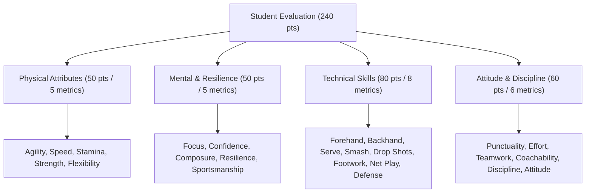

# 🏢 Sports Academy Admin Panel - Complete Frontend API & Integration Documentation

> **Version:** 1.0.0  
> **API Base URL (Production):** `https://www.amdplayapi.amdtechno.in/api/v1`  
> **Direct Server URL:** `https://amdplayapi.amdtechno.in/api/v1`  
> **Local Development URL:** `http://localhost:5005/api/v1`  
> **Interactive Swagger UI:** [https://www.amdplayapi.amdtechno.in/api/docs](https://www.amdplayapi.amdtechno.in/api/docs) *(Select "🏢 2. Admin Management API" in the dropdown)*

---

## Table of Contents
1. [Architecture & Common Standards](#1-architecture--common-standards)
   - [Base URLs & Environment Setup](#base-urls--environment-setup)
   - [Authentication & JWT Token Lifecycle](#authentication--jwt-token-lifecycle)
   - [Tenant & Branch Context Headers](#tenant--branch-context-headers)
   - [Standard Request & Response Envelopes](#standard-request--response-envelopes)
   - [Standard Error Codes & Handling](#standard-error-codes--handling)
2. [Authentication & Session Management](#2-authentication--session-management)
3. [Dashboard & Analytics](#3-dashboard--analytics)
4. [Academy Configuration & Branch Management](#4-academy-configuration--branch-management)
5. [Sports Master & Resources (Courts / Turfs / Relays)](#5-sports-master--resources-courts--turfs--relays)
6. [Slot Availability Grid & Dynamic Pricing](#6-slot-availability-grid--dynamic-pricing)
7. [Court Bookings & Gate Access Control](#7-court-bookings--gate-access-control)
8. [Coaching Academy (Batches, Schedules & Attendance)](#8-coaching-academy-batches-schedules--attendance)
9. [Student Evaluations & 24-Metric Performance Scorecard](#9-student-evaluations--24-metric-performance-scorecard)
10. [Students & Sibling Family Management](#10-students--sibling-family-management)
11. [Staff & HR Management (Coaches, Admins, Desk Staff)](#11-staff--hr-management-coaches-admins-desk-staff)
12. [Members & Subscriptions](#12-members--subscriptions)
13. [Finance, 1st-of-Month Fees & Expenses](#13-finance-1st-of-month-fees--expenses)
14. [Customer CRM & Enquiries](#14-customer-crm--enquiries)
15. [Announcements & Notification Center](#15-announcements--notification-center)
16. [IoT Hardware Automation (Hikvision & Smart Relays)](#16-iot-hardware-automation-hikvision--smart-relays)
17. [Skills & Progression Levels Master](#17-skills--progression-levels-master)
18. [Events & Tournaments](#18-events--tournaments)
19. [Frontend Implementation Guide & Code Snippets](#19-frontend-implementation-guide--code-snippets)

---

## 1. Architecture & Common Standards

### Base URLs & Environment Setup

| Environment | Base URL | Notes |
|:---|:---|:---|
| **Production** | `https://www.amdplayapi.amdtechno.in/api/v1` | Primary SSL CDN |
| **Direct Production** | `https://amdplayapi.amdtechno.in/api/v1` | Fallback direct host |
| **Local / Staging** | `http://localhost:5005/api/v1` | Local backend port 5005 |

### Authentication & JWT Token Lifecycle
1. Admin, Branch Manager, or Coach logs in using `/auth/tenant/login` or `/auth/login`.
2. The server responds with:
   - `accessToken`: Short-lived JSON Web Token (pass in `Authorization: Bearer <accessToken>`).
   - `refreshToken`: Long-lived token used to refresh expired sessions.
   - `user`: Identity object containing `id`, `role`, `tenantId`, `branchId`, `permissions`, and profile metadata.
3. When `accessToken` expires (HTTP `401 Unauthorized`), call `POST /api/v1/auth/refresh` using the `refreshToken` to receive a fresh token pair.

### Tenant & Branch Context Headers
All administrative calls must supply the Bearer token. For multi-branch or multi-tenant operations, include these optional context headers:

| Header Name | Type | Description |
|:---|:---|:---|
| `Authorization` | `string` | **Required.** `Bearer <accessToken>` |
| `Content-Type` | `string` | **Required.** `application/json` |
| `x-tenant-id` | `string` | Tenant ID (Inherited from JWT, but can be explicitly passed) |
| `x-branch-id` | `string` | Active Branch ID (Used when an Admin switches branch view) |

### Standard Request & Response Envelopes

#### Success Response Envelope (`200 OK`, `201 Created`)
```json
{
  "success": true,
  "message": "Resource retrieved / operation successful",
  "data": {},
  "meta": {
    "total": 120,
    "page": 1,
    "limit": 20,
    "totalPages": 6
  }
}
```

#### Error Response Envelope (`400`, `401`, `403`, `404`, `500`)
```json
{
  "success": false,
  "error": {
    "code": "VALIDATION_ERROR",
    "message": "Detailed error explanation",
    "details": [
      {
        "field": "phone",
        "message": "Phone number is required"
      }
    ]
  }
}
```

### Standard Error Codes & Handling
- `400 Bad Request`: Payload validation failed (`VALIDATION_ERROR`). Verify types and required fields.
- `401 Unauthorized`: Token missing, expired, or invalid. Trigger silent token refresh or redirect to login.
- `403 Forbidden`: Authenticated user lacks permission (`FORBIDDEN`).
- `404 Not Found`: Target ID or document does not exist (`NOT_FOUND`).
- `409 Conflict`: Duplicate entry (e.g., student employeeNo already registered, slot already booked).
- `500 Internal Server Error`: Server exception. Display a toast notification with the server error message.

---

## 2. Authentication & Session Management

### 2.1 Admin / Staff / Coach Login
Authenticates tenant administrative users, branch managers, desk staff, and coaches.

- **Endpoint:** `POST /api/v1/auth/tenant/login`
- **Access:** Public
- **Request Body:**
  ```json
  {
    "username": "admin@amdplay.in",
    "password": "YourPassword@123",
    "tenantSlug": "amd-sports-hub" 
  }
  ```
  *(Note: `username` can be email or phone. `tenantSlug` is optional if the email or phone is unique).*

- **Success Response (`200 OK`):**
  ```json
  {
    "success": true,
    "message": "Login successful",
    "data": {
      "accessToken": "eyJhbGciOi...",
      "refreshToken": "eyJhbGciOi...",
      "user": {
        "id": "6adf447b60f40fbec7d827a8",
        "email": "admin@amdplay.in",
        "phone": "9894789477",
        "firstName": "Arun",
        "lastName": "Devan",
        "role": "tenant_admin",
        "tenantId": "6ad6bd7fd33a91a36c41ff44",
        "branchId": "6ad6bd7fd33a91a36c41ff46",
        "permissions": ["all"]
      }
    }
  }
  ```

### 2.2 Get Current User Profile & Context
Fetch profile and active session parameters of the logged-in administrator.

- **Endpoint:** `GET /api/v1/auth/me`
- **Headers:** `Authorization: Bearer <accessToken>`
- **Success Response (`200 OK`):**
  ```json
  {
    "success": true,
    "data": {
      "user": {
        "id": "6adf447b60f40fbec7d827a8",
        "firstName": "Arun",
        "lastName": "Devan",
        "role": "tenant_admin",
        "email": "admin@amdplay.in",
        "phone": "9894789477",
        "tenantId": "6ad6bd7fd33a91a36c41ff44",
        "branchId": "6ad6bd7fd33a91a36c41ff46"
      }
    }
  }
  ```

### 2.3 Refresh Token
Exchange refresh token for a new access token when JWT expires.

- **Endpoint:** `POST /api/v1/auth/refresh`
- **Request Body:**
  ```json
  {
    "refreshToken": "eyJhbGciOi..."
  }
  ```
- **Response (`200 OK`):**
  ```json
  {
    "success": true,
    "data": {
      "accessToken": "eyJhbGciOi...",
      "refreshToken": "eyJhbGciOi..."
    }
  }
  ```

### 2.4 Logout
Revokes current user session tokens.

- **Endpoint:** `POST /api/v1/auth/logout`
- **Headers:** `Authorization: Bearer <accessToken>`
- **Request Body:** `{}`
- **Response (`200 OK`):**
  ```json
  {
    "success": true,
    "message": "Logged out successfully"
  }
  ```

### 2.5 Change Password (Authenticated User)
- **Endpoint:** `POST /api/v1/auth/change-password`
- **Headers:** `Authorization: Bearer <accessToken>`
- **Request Body:**
  ```json
  {
    "currentPassword": "OldPassword@123",
    "newPassword": "NewPassword@123"
  }
  ```

### 2.6 Reset Any User / Student Password (Direct Admin Action)
Allows Tenant Admin or Branch Manager to reset a student, coach, or staff password directly without OTP.

- **Endpoint:** `POST /api/v1/auth/users/:id/reset-password`  
  *(Alias for students: `POST /api/v1/students/:id/reset-password`)*
- **Headers:** `Authorization: Bearer <accessToken>`
- **Request Body:**
  ```json
  {
    "newPassword": "Isa@123"
  }
  ```
- **Response (`200 OK`):**
  ```json
  {
    "success": true,
    "message": "Password updated successfully"
  }
  ```

---

## 3. Dashboard & Analytics

### 3.1 Executive Summary & KPI Cards
Powers the top analytics cards on the main Admin dashboard.

- **Endpoint:** `GET /api/v1/analytics/dashboard`
- **Headers:** `Authorization: Bearer <accessToken>`
- **Query Parameters:**
  - `branchId` *(optional)*: Filter by specific branch ID.
  - `startDate` *(optional)*: `YYYY-MM-DD`
  - `endDate` *(optional)*: `YYYY-MM-DD`
  - `range` *(optional)*: `today`, `this_week`, `this_month`, `this_year`
- **Response (`200 OK`):**
  ```json
  {
    "success": true,
    "data": {
      "currency": "INR",
      "dateRange": {
        "startDate": "2026-11-01",
        "endDate": "2026-11-30"
      },
      "totalRevenue": 245000,
      "totalBookings": 138,
      "activeCourts": 6,
      "activeMembers": 52,
      "enrolledStudents": 140,
      "pendingExpenses": {
        "count": 3,
        "amount": 7500
      }
    }
  }
  ```

### 3.2 Court Utilization & Hourly Heatmap
Returns court usage statistics and hourly peak/off-peak occupancy.

- **Endpoint:** `GET /api/v1/analytics/court-utilization`
- **Headers:** `Authorization: Bearer <accessToken>`
- **Query Parameters:** `branchId`, `sportId`, `startDate`, `endDate`
- **Response (`200 OK`):**
  ```json
  {
    "success": true,
    "data": {
      "overallUtilizationPercentage": 74.5,
      "totalSlotsAvailable": 480,
      "totalSlotsBooked": 358,
      "courts": [
        {
          "courtId": "6ae101a9185e913f71898111",
          "courtName": "Badminton Court 1",
          "bookedHours": 68,
          "utilizationRate": 82.0
        }
      ],
      "peakHours": ["18:00", "19:00", "20:00", "21:00"]
    }
  }
  ```

### 3.3 Revenue Analytics & Trends
- **Endpoint:** `GET /api/v1/analytics/revenue`
- **Query Parameters:** `branchId`, `startDate`, `endDate`, `groupBy` (`day`, `week`, `month`)
- **Response (`200 OK`):**
  ```json
  {
    "success": true,
    "data": {
      "totalRevenue": 245000,
      "breakdown": {
        "courtBookings": 115000,
        "coachingFees": 98000,
        "memberships": 32000
      },
      "trends": [
        { "date": "2026-11-01", "revenue": 12500 },
        { "date": "2026-11-02", "revenue": 14200 }
      ]
    }
  }
  ```

### 3.4 Student & Coach Attendance Analytics
- **Endpoint:** `GET /api/v1/analytics/attendance`
- **Query Parameters:** `branchId`, `batchId`, `startDate`, `endDate`

---

## 4. Academy Configuration & Branch Management

### 4.1 Academy Organization Details
- **Get Academy Profile:** `GET /api/v1/academies/:id`
- **Update Academy Profile:** `PATCH /api/v1/academies/:id`
- **Payload Example:**
  ```json
  {
    "name": "AMD Sports Arena",
    "phone": "9894789477",
    "email": "contact@amdsports.in",
    "address": {
      "street": "12 Main Road",
      "city": "Chennai",
      "state": "Tamil Nadu",
      "zipCode": "600028"
    }
  }
  ```

### 4.2 Academy Settings (Branding, Gateways, WhatsApp)
- **Get Settings:** `GET /api/v1/settings`
- **Update Settings:** `PATCH /api/v1/settings`
- **Payload Example:**
  ```json
  {
    "branding": {
      "primaryColor": "#1E40AF",
      "logoUrl": "https://cdn.amdplay.in/logo.png"
    },
    "paymentGateways": {
      "razorpay": {
        "enabled": true,
        "keyId": "rzp_live_xxxxxx",
        "keySecret": "xxxxxx"
      }
    },
    "whatsapp": {
      "enabled": true,
      "provider": "wati",
      "apiKey": "xxxxxx"
    }
  }
  ```
- **Test WhatsApp Message:** `POST /api/v1/settings/whatsapp/test`
- **Test Payment Gateway:** `POST /api/v1/settings/payment-gateways/test`

### 4.3 Branches Management

| Method | Endpoint | Description |
|:---|:---|:---|
| `GET` | `/api/v1/branches` | List all branches with pagination & search |
| `GET` | `/api/v1/branches/active` | Dropdown list of all active branches |
| `POST` | `/api/v1/branches` | Create a new branch |
| `GET` | `/api/v1/branches/:id` | Get branch details |
| `PATCH` | `/api/v1/branches/:id` | Update branch address, contact, and hours |
| `DELETE` | `/api/v1/branches/:id` | Deactivate/delete branch |

**Create Branch Payload:**
```json
{
  "name": "Anna Nagar Branch",
  "code": "BR-AN-01",
  "phone": "9894789477",
  "email": "annanagar@amdsports.in",
  "address": {
    "street": "Plot 42, 2nd Avenue",
    "city": "Chennai",
    "state": "Tamil Nadu",
    "zipCode": "600040"
  },
  "operatingHours": {
    "openTime": "05:00",
    "closeTime": "23:00"
  }
}
```

---

## 5. Sports Master & Resources (Courts / Turfs / Relays)

### 5.1 Sports Master Catalog

| Method | Endpoint | Description |
|:---|:---|:---|
| `GET` | `/api/v1/sports` | List all available sports (Badminton, Football, Tennis, Cricket) |
| `POST` | `/api/v1/sports` | Add new sport to master catalog |
| `PATCH` | `/api/v1/sports/:id` | Update sport properties and icon |
| `DELETE` | `/api/v1/sports/:id` | Delete sport |

### 5.2 Resources / Courts Management

| Method | Endpoint | Description |
|:---|:---|:---|
| `GET` | `/api/v1/resources` | List all courts/resources (alias `/api/v1/courts`) |
| `GET` | `/api/v1/resources/active` | Active courts for booking dropdown |
| `POST` | `/api/v1/resources` | Create a new court / turf |
| `GET` | `/api/v1/resources/:id` | Get court details, pricing & IoT relays |
| `PATCH` | `/api/v1/resources/:id` | Update court name, pricing, or status |
| `POST` | `/api/v1/resources/:id/maintenance` | Put court into maintenance or release it |

**Create Court Payload:**
```json
{
  "branchId": "6ad6bd7fd33a91a36c41ff46",
  "sportId": "6ad6bd7fd33a91a36c41ff99",
  "name": "Badminton Court 1",
  "type": "court",
  "slotDurationMinutes": 60,
  "baseHourlyRate": 400,
  "peakHourlyRate": 550,
  "status": "active",
  "iotRelayMapping": {
    "deviceId": "6ad899efd11a91a36c41ff12",
    "channel": 1
  }
}
```

---

## 6. Slot Availability Grid & Dynamic Pricing

### 6.1 Real-Time Court Slot Grid
Used by the Admin Desk and Booking UI to render the court schedule matrix.

- **Endpoint:** `GET /api/v1/slots/grid`
- **Query Parameters:**
  - `date`: `YYYY-MM-DD` *(Required)*
  - `branchId`: Branch ID *(Required)*
  - `sportId`: Sport ID *(Optional)*
- **Response (`200 OK`):**
  ```json
  {
    "success": true,
    "data": {
      "date": "2026-11-12",
      "courts": [
        {
          "courtId": "6ae101a9185e913f71898111",
          "courtName": "Badminton Court 1",
          "slots": [
            {
              "startTime": "06:00",
              "endTime": "07:00",
              "status": "available",
              "price": 400,
              "isPeak": false
            },
            {
              "startTime": "07:00",
              "endTime": "08:00",
              "status": "booked",
              "bookingId": "6ae8921a185e913f71898999",
              "customerName": "Ramesh Kumar",
              "isPeak": false
            },
            {
              "startTime": "08:00",
              "endTime": "09:00",
              "status": "held",
              "holdExpiresAt": "2026-11-12T08:05:00Z"
            }
          ]
        }
      ]
    }
  }
  ```

### 6.2 Atomic Slot Holds (5-Minute Lock)
Prevents double booking while desk staff or customers are filling checkout details.

- **Hold Single Slot:** `POST /api/v1/slots/hold`
- **Release Single Slot:** `POST /api/v1/slots/release`
- **Multi-Slot Hold:** `POST /api/v1/slots/multi-hold`
- **Request Body (`POST /api/v1/slots/hold`):**
  ```json
  {
    "resourceId": "6ae101a9185e913f71898111",
    "date": "2026-11-12",
    "startTime": "06:00",
    "endTime": "07:00"
  }
  ```

---

## 7. Court Bookings & Gate Access Control

### 7.1 Bookings Management Endpoints

| Method | Endpoint | Description |
|:---|:---|:---|
| `GET` | `/api/v1/bookings` | List all bookings with search, date range, branch, court, and status filters |
| `POST` | `/api/v1/bookings` | Create a new booking (Walk-in / Desk booking) |
| `POST` | `/api/v1/bookings/multi` | Create multi-court or multi-slot booking |
| `GET` | `/api/v1/bookings/:id` | Full booking details, 6-digit gate PIN, and receipt |
| `POST` | `/api/v1/bookings/:id/cancel` | Cancel booking and release court slot |
| `POST` | `/api/v1/bookings/:id/check-in` | Mark customer checked in at desk |
| `POST` | `/api/v1/bookings/:id/sync-pin` | Force push 6-digit PIN to turnstile device |
| `GET` | `/api/v1/bookings/:id/invoice` | Download / view printable tax invoice |

### 7.2 Create Walk-In Booking (Admin Desk)
- **Endpoint:** `POST /api/v1/bookings`
- **Request Body:**
  ```json
  {
    "branchId": "6ad6bd7fd33a91a36c41ff46",
    "resourceId": "6ae101a9185e913f71898111",
    "date": "2026-11-12",
    "startTime": "18:00",
    "endTime": "19:00",
    "customer": {
      "fullName": "Suresh Raina",
      "phone": "9876543210",
      "email": "suresh@example.com"
    },
    "payment": {
      "method": "cash",
      "amount": 550,
      "status": "paid"
    },
    "notes": "Walk-in cash booking at front desk"
  }
  ```

- **Success Response (`201 Created`):**
  ```json
  {
    "success": true,
    "message": "Court booked successfully",
    "data": {
      "bookingId": "6af99281185e913f71898333",
      "bookingNumber": "BK-20261112-0045",
      "status": "confirmed",
      "gatePass": {
        "pin": "482910",
        "qrCodeData": "PASS:BK-20261112-0045:482910",
        "validFrom": "2026-11-12T17:45:00Z",
        "validUntil": "2026-11-12T19:15:00Z"
      },
      "totalAmount": 550,
      "paymentStatus": "paid"
    }
  }
  ```

---

## 8. Coaching Academy (Batches, Schedules & Attendance)

### 8.1 Coaching Batches Endpoints

| Method | Endpoint | Description |
|:---|:---|:---|
| `GET` | `/api/v1/coaching/batches` | List all coaching batches with branch, sport, coach, and status filters |
| `POST` | `/api/v1/coaching/batches` | Create a new coaching batch cohort |
| `GET` | `/api/v1/coaching/batches/:id` | Get batch profile, assigned courts, and enrolled students |
| `PATCH` | `/api/v1/coaching/batches/:id` | Update batch timings, fees, courts, or coach |
| `DELETE` | `/api/v1/coaching/batches/:id` | Archive / delete batch |

**Create Coaching Batch Payload:**
```json
{
  "branchId": "6ad6bd7fd33a91a36c41ff46",
  "sportId": "6ad6bd7fd33a91a36c41ff99",
  "coachId": "6adf447b60f40fbec7d827a8",
  "courtIds": ["6ae101a9185e913f71898111"],
  "name": "Badminton Morning Elite Stars",
  "code": "BAT-BD-0630",
  "level": "intermediate",
  "schedule": {
    "daysOfWeek": [1, 2, 3, 4, 5],
    "startTime": "06:30",
    "endTime": "08:00"
  },
  "maxStudents": 25,
  "monthlyFee": 2500
}
```

### 8.2 Enroll Student in Batch
- **Endpoint:** `POST /api/v1/coaching/enrollments`
- **Request Body:**
  ```json
  {
    "batchId": "6ae101a9185e913f71898555",
    "studentId": "6ae3bfa56989d6280874ef35",
    "monthlyFee": 2500,
    "notes": "Direct enrollment"
  }
  ```

### 8.3 Mark Daily Batch Attendance
Allows coaches or desk administrators to submit roll-call attendance for a batch session.

- **Endpoint:** `POST /api/v1/coaching/attendance/mark` *(or `POST /api/v1/students/attendance/mark`)*
- **Request Body:**
  ```json
  {
    "batchId": "6ae101a9185e913f71898555",
    "date": "2026-11-12",
    "records": [
      {
        "studentId": "6ae3bfa56989d6280874ef35",
        "status": "present",
        "remarks": "On time"
      },
      {
        "studentId": "6af1e2ae185e913f71898a76",
        "status": "absent",
        "remarks": "Informed leave"
      }
    ]
  }
  ```

---

## 9. Student Evaluations & 24-Metric Performance Scorecard

### 9.1 The 24 Assessment Parameters Architecture
The academy uses a 24-parameter evaluation engine split into 4 categories (Total Score: 240, 10 points per metric):



### 9.2 Submit Student Evaluation
Creates a new performance scorecard. Automatically calculates totals, percentages, letter grade (`A+`, `A`, `B`, etc.), and updates the student's latest scorecard.

- **Endpoint:** `POST /api/v1/coaching/evaluations`
- **Headers:** `Authorization: Bearer <accessToken>`
- **Request Body:**
  ```json
  {
    "studentId": "6af1e2ae185e913f71898a76",
    "batchId": "6ae101a9185e913f71898555",
    "period": "November 2026",
    "evaluationDate": "2026-11-12",
    "ratings": {
      "agility": 10,
      "speed": 9,
      "stamina": 10,
      "strength": 9,
      "flexibility": 10,
      "focus": 10,
      "confidence": 10,
      "composure": 10,
      "resilience": 10,
      "sportsmanship": 10,
      "forehandStrokes": 9,
      "backhandStrokes": 9,
      "serve": 10,
      "smash": 9,
      "dropShots": 9,
      "footwork": 9,
      "netPlay": 10,
      "defensiveSkills": 9,
      "punctuality": 10,
      "effort": 10,
      "teamwork": 10,
      "coachability": 10,
      "discipline": 10,
      "positiveAttitude": 10
    },
    "coachRemarks": "Outstanding work ethic and agility across all badminton drills.",
    "status": "published"
  }
  ```

> [!TIP]
> The backend accepts either:
> 1. Full 24-metric map in `ratings: { ... }` (1-10 per metric).
> 2. Category sliders: `physicalScore` (0-50), `mentalScore` (0-50), `skillScore` (0-80), `attitudeScore` (0-60).

- **Success Response (`201 Created`):**
  ```json
  {
    "success": true,
    "message": "Student evaluation recorded successfully",
    "data": {
      "id": "6af8991a185e913f71898777",
      "student": {
        "id": "6af1e2ae185e913f71898a76",
        "fullName": "RUTHVI PANDIAN",
        "regNo": "isabd006"
      },
      "period": "November 2026",
      "scores": {
        "physical": 48,
        "mental": 50,
        "skill": 74,
        "attitude": 60,
        "total": 232,
        "maxScore": 240,
        "percentage": 96.67,
        "grade": "A+",
        "performanceLevel": "OUTSTANDING"
      },
      "radarData": [
        { "category": "Physical", "score": 48, "max": 50 },
        { "category": "Mental", "score": 50, "max": 50 },
        { "category": "Technical", "score": 74, "max": 80 },
        { "category": "Attitude", "score": 60, "max": 60 }
      ],
      "coachRemarks": "Outstanding work ethic and agility across all badminton drills."
    }
  }
  ```

### 9.3 List Evaluations
- **Endpoint:** `GET /api/v1/coaching/evaluations`
- **Query Parameters:**
  - `studentId` *(optional)*: Filter for a specific student.
  - `batchId` *(optional)*: Filter by batch.
  - `coachId` *(optional)*: Filter by evaluating coach.
  - `search` / `q` *(optional)*: Search student name or registration number.
  - `allHistory` *(optional)*: Pass `false` (default) to show only the **latest record per student**, or `true` to view historical evaluations.
  - `page`: Page number (default: 1).
  - `limit`: Items per page (default: 20).

---

## 10. Students & Sibling Family Management

### 10.1 Student CRUD Endpoints

| Method | Endpoint | Description |
|:---|:---|:---|
| `GET` | `/api/v1/students` | List all students with search, branch, batch, and status filters |
| `GET` | `/api/v1/students/dropdown` | Lightweight dropdown list (ID, name, phone, batch, regNo) |
| `POST` | `/api/v1/students` | Onboard a new student trainee and enroll in batch |
| `GET` | `/api/v1/students/:id` | Full 360 profile (Batches, Attendance, Fees, Siblings, Biometrics) |
| `PATCH` | `/api/v1/students/:id` | Update profile, contacts, batch assignment, or status |
| `DELETE` | `/api/v1/students/:id` | Deactivate/remove student |
| `POST` | `/api/v1/students/:id/face` | Upload student photo (Base64) to sync to Hikvision biometric face terminal |
| `POST` | `/api/v1/students/:id/reset-password` | Reset student login password (Default: `Isa@123`) |

### 10.2 Register New Student Payload
```json
{
  "branchId": "6ad6bd7fd33a91a36c41ff46",
  "batchId": "6ae101a9185e913f71898555",
  "sportId": "6ad6bd7fd33a91a36c41ff99",
  "firstName": "Keshika",
  "lastName": "Devan",
  "phone": "9894789477",
  "email": "keshika@example.com",
  "dateOfBirth": "2014-06-15",
  "gender": "Female",
  "employeeNo": "isabd001",
  "cardNo": "CARD98210",
  "pin": "123456",
  "monthlyFee": 2500,
  "parentName": "Arunmozhidevan",
  "parentPhone": "9894789477",
  "skillLevel": "beginner",
  "notes": "Beginner morning batch"
}
```

> [!NOTE]
> If `employeeNo`, `cardNo`, or `pin` are omitted, the backend automatically generates next sequential values (e.g. `isabd001`).

### 10.3 Sibling Family Management
Siblings who enroll with the **same parent phone number** are automatically grouped into a family group. The frontend can also manually link existing students who have different numbers, or assign a distinct phone number to an individual child.

#### A. Manual Link Existing Students as Siblings
Links a new student to a master student. Automatically inherits the master student's `siblingGroupId`, parent contact number, and guardian name.

- **Endpoint:** `POST /api/v1/students/siblings`
- **Request Body:**
  ```json
  {
    "masterStudentId": "6ae3bfa56989d6280874ef35",
    "newStudentId": "6af1e2ae185e913f71898a76"
  }
  ```
- **Success Response (`200 OK`):**
  ```json
  {
    "success": true,
    "message": "Students linked into sibling family group successfully",
    "data": {
      "student": {
        "studentId": "6ae3bfa56989d6280874ef35",
        "fullName": "Keshika Devan",
        "regNo": "isabd001",
        "siblingGroupId": "6af4929053cf12c1662f4b5a"
      },
      "siblingCount": 1,
      "familyPhone": "9894789477",
      "parentName": "Arunmozhidevan",
      "siblings": [
        {
          "studentId": "6af1e2ae185e913f71898a76",
          "fullName": "RUTHVI PANDIAN",
          "regNo": "isabd006",
          "phone": "9444154854",
          "siblingGroupId": "6af4929053cf12c1662f4b5a"
        }
      ]
    }
  }
  ```

#### B. Assign Different Mobile Number to Sibling
Updates an individual child's phone number without breaking their family sibling link.

- **Endpoint:** `PATCH /api/v1/students/:id/phone` *(or `PATCH /api/v1/coaching/students/:id/sibling-phone`)*
- **Request Body:**
  ```json
  {
    "phone": "9444154854"
  }
  ```

#### C. Get All Siblings of a Student
- **Endpoint:** `GET /api/v1/students/:id/siblings`

#### D. List All Sibling Groups
- **Endpoint:** `GET /api/v1/students/siblings`

---

## 11. Staff & HR Management (Coaches, Admins, Desk Staff)

### 11.1 Staff Directory Endpoints

| Method | Endpoint | Description |
|:---|:---|:---|
| `GET` | `/api/v1/staff` | List staff with filters (branch, department, designation, role, search) |
| `POST` | `/api/v1/staff` | Register new staff member / coach |
| `GET` | `/api/v1/staff/:id` | Staff profile details |
| `PATCH` | `/api/v1/staff/:id` | Update staff details, status, department, or role |
| `DELETE` | `/api/v1/staff/:id` | Deactivate staff member |
| `GET` | `/api/v1/staff/:id/batches` | List coaching batches assigned to a coach |
| `GET` | `/api/v1/staff/roles` | Available staff system roles |

**Register Staff Payload:**
```json
{
  "branchId": "6ad6bd7fd33a91a36c41ff46",
  "firstName": "Girish",
  "lastName": "Kumar",
  "phone": "9894789477",
  "email": "girish.coach@amdplay.in",
  "role": "coach",
  "departmentId": "6ae101a9185e913f71898222",
  "designationId": "6ae101a9185e913f71898333",
  "salary": 35000,
  "password": "Isa@123"
}
```

### 11.2 Departments & Designations
- **List Departments:** `GET /api/v1/staff/departments`
- **Create Department:** `POST /api/v1/staff/departments`
- **List Designations:** `GET /api/v1/staff/designations`
- **Create Designation:** `POST /api/v1/staff/designations`

---

## 12. Members & Subscriptions

### 12.1 Membership Plans Management

| Method | Endpoint | Description |
|:---|:---|:---|
| `GET` | `/api/v1/memberships/plans` | List all membership plans |
| `GET` | `/api/v1/memberships/plans/active` | Active plans for signup dropdown |
| `POST` | `/api/v1/memberships/plans` | Create a new membership plan |
| `PATCH` | `/api/v1/memberships/plans/:id` | Update plan price, duration, benefits |
| `DELETE` | `/api/v1/memberships/plans/:id` | Delete plan |

### 12.2 Members Directory

| Method | Endpoint | Description |
|:---|:---|:---|
| `GET` | `/api/v1/members` | List active & expired members with search & filters |
| `POST` | `/api/v1/members` | Register member |
| `GET` | `/api/v1/members/:id` | Member profile 360 |
| `POST` | `/api/v1/memberships/subscribe` | Assign membership plan to member |

---

## 13. Finance, 1st-of-Month Fees & Expenses

### 13.1 Monthly Coaching Fees Management

| Method | Endpoint | Description |
|:---|:---|:---|
| `GET` | `/api/v1/finance/monthly-fees` | List monthly fee invoices (Filter by month, year, status, batchId, studentId) |
| `POST` | `/api/v1/finance/monthly-fees/generate` | Trigger automated fee generation for all active students / members |
| `PATCH` | `/api/v1/finance/monthly-fees/:id/pay` | Record 1-tap offline payment (Cash, UPI, Card, Netbanking) |
| `POST` | `/api/v1/finance/monthly-fees/:id/razorpay/order` | Create Razorpay order for online payment link |
| `POST` | `/api/v1/finance/monthly-fees/:id/razorpay/verify` | Verify Razorpay payment signature |

**Record Fee Payment Payload (`PATCH /api/v1/finance/monthly-fees/:id/pay`):**
```json
{
  "paymentMethod": "upi",
  "paidAmount": 2500,
  "transactionReference": "UPI98234821093",
  "notes": "Paid at academy front desk"
}
```

### 13.2 Operational Expenses Tracker

| Method | Endpoint | Description |
|:---|:---|:---|
| `GET` | `/api/v1/finance/expenses` | List expenses with category, status, date range filters |
| `POST` | `/api/v1/finance/expenses` | Record a new expense |
| `PATCH` | `/api/v1/finance/expenses/:id/approve` | Approve or reject a recorded expense |
| `DELETE` | `/api/v1/finance/expenses/:id` | Delete expense entry |

**Record Expense Payload:**
```json
{
  "branchId": "6ad6bd7fd33a91a36c41ff46",
  "category": "electricity",
  "title": "EB Bill for November 2026",
  "amount": 14500,
  "date": "2026-11-12",
  "paidTo": "TNEB",
  "paymentMethod": "bank_transfer",
  "notes": "Court lighting electricity meter bill"
}
```

### 13.3 Financial Summary & P&L Report
- **Endpoint:** `GET /api/v1/finance/reports/summary`
- **Query Parameters:** `branchId`, `startDate`, `endDate`
- **Response (`200 OK`):**
  ```json
  {
    "success": true,
    "data": {
      "totalRevenue": 245000,
      "totalExpenses": 58000,
      "netProfit": 187000,
      "profitMarginPercentage": 76.33
    }
  }
  ```

---

## 14. Customer CRM & Enquiries

| Method | Endpoint | Description |
|:---|:---|:---|
| `GET` | `/api/v1/enquiries` | List all inquiries with status (`new`, `contacted`, `trial_scheduled`, `enrolled`, `lost`) |
| `POST` | `/api/v1/enquiries` | Create a new walk-in / phone lead |
| `GET` | `/api/v1/enquiries/:id` | View lead details and follow-up timeline |
| `PATCH` | `/api/v1/enquiries/:id` | Update lead status or assign to staff |
| `POST` | `/api/v1/enquiries/:id/notes` | Append internal staff follow-up note |

---

## 15. Announcements & Notification Center

### 15.1 Announcements
- **List Announcements:** `GET /api/v1/announcements`
- **Publish Announcement:** `POST /api/v1/announcements`
  ```json
  {
    "title": "Academy Closed for Deepavali",
    "content": "All batches will resume on Tuesday.",
    "targetAudience": ["students", "members"],
    "priority": "high",
    "expiresAt": "2026-11-15T23:59:59Z"
  }
  ```
- **Delete Announcement:** `DELETE /api/v1/announcements/:id`

### 15.2 Notification Center
- **Send Notification Broadcast:** `POST /api/v1/notifications/send`
- **Admin Inbox:** `GET /api/v1/notifications`
- **Unread Count:** `GET /api/v1/notifications/unread-count`
- **Mark as Read:** `PATCH /api/v1/notifications/:id/read`
- **Mark All Read:** `PATCH /api/v1/notifications/read-all`

---

## 16. IoT Hardware Automation (Hikvision & Smart Relays)

### 16.1 IoT Devices List & Relay Control

| Method | Endpoint | Description |
|:---|:---|:---|
| `GET` | `/api/v1/iot/devices` | List registered edge devices, IP, status (Online/Offline) |
| `POST` | `/api/v1/iot/devices` | Register a Hikvision terminal or 4/8-channel smart relay |
| `POST` | `/api/v1/iot/devices/:id/relay` | Toggle single relay channel (e.g. Channel 1 = Court 1 Lights) |
| `POST` | `/api/v1/iot/devices/:id/all-relays` | Master ON / Master OFF for all channels |
| `POST` | `/api/v1/iot/courts/:resourceId/lighting` | Turn court lights ON/OFF directly by Court ID |

**Toggle Court Lighting Payload (`POST /api/v1/iot/courts/:resourceId/lighting`):**
```json
{
  "state": "on",
  "reason": "Manual Admin override from dashboard"
}
```

---

## 17. Skills & Progression Levels Master

- **List Skill Categories:** `GET /api/v1/skills`
- **List Skill Levels (Beginner, Intermediate, Advanced, Elite):** `GET /api/v1/skill-levels`
- **Create Level:** `POST /api/v1/skill-levels`
- **Update Level:** `PATCH /api/v1/skill-levels/:id`

---

## 18. Events & Tournaments

- **List Tournaments:** `GET /api/v1/events`
- **Create Tournament:** `POST /api/v1/events`
- **Register Participant:** `POST /api/v1/events/:eventId/register`

---

## 19. Frontend Implementation Guide & Code Snippets

### 19.1 Axios API Client with Auto-Refresh & Tenant Headers

```typescript
// src/api/apiClient.ts
import axios from 'axios';

const API_BASE_URL = process.env.NEXT_PUBLIC_API_URL || 'https://www.amdplayapi.amdtechno.in/api/v1';

export const apiClient = axios.create({
  baseURL: API_BASE_URL,
  headers: {
    'Content-Type': 'application/json',
  },
});

// Request Interceptor: Attach Access Token and Tenant/Branch Context
apiClient.interceptors.request.use((config) => {
  const token = localStorage.getItem('accessToken');
  const branchId = localStorage.getItem('activeBranchId');
  const tenantId = localStorage.getItem('tenantId');

  if (token) {
    config.headers.Authorization = `Bearer ${token}`;
  }
  if (branchId) {
    config.headers['x-branch-id'] = branchId;
  }
  if (tenantId) {
    config.headers['x-tenant-id'] = tenantId;
  }
  return config;
});

// Response Interceptor: Handle Token Expiry & Silent Refresh
apiClient.interceptors.response.use(
  (response) => response,
  async (error) => {
    const originalRequest = error.config;
    if (error.response?.status === 401 && !originalRequest._retry) {
      originalRequest._retry = true;
      try {
        const refreshToken = localStorage.getItem('refreshToken');
        if (!refreshToken) throw new Error('No refresh token available');

        const { data } = await axios.post(`${API_BASE_URL}/auth/refresh`, { refreshToken });
        const newAccessToken = data.data.accessToken;

        localStorage.setItem('accessToken', newAccessToken);
        originalRequest.headers.Authorization = `Bearer ${newAccessToken}`;

        return apiClient(originalRequest);
      } catch (refreshError) {
        localStorage.clear();
        window.location.href = '/login';
        return Promise.reject(refreshError);
      }
    }
    return Promise.reject(error);
  }
);
```

### 19.2 TypeScript Interface Definitions

```typescript
// src/types/models.ts

export type UserRole =
  | 'super_admin'
  | 'tenant_admin'
  | 'branch_manager'
  | 'coach'
  | 'staff'
  | 'member'
  | 'student'
  | 'customer';

export interface User {
  id: string;
  email?: string;
  phone: string;
  firstName: string;
  lastName?: string;
  role: UserRole;
  tenantId: string;
  branchId?: string;
}

export interface Student {
  id: string;
  fullName: string;
  firstName: string;
  lastName?: string;
  regNo?: string;
  phone: string;
  email?: string;
  skillLevel: string;
  batchId?: string;
  batchName?: string;
  siblingGroupId?: string;
  isSibling?: boolean;
  parentName?: string;
  parentPhone?: string;
  monthlyFee: number;
  status: 'active' | 'inactive' | 'suspended';
}

export interface EvaluationPayload {
  studentId: string;
  batchId?: string;
  period?: string;
  evaluationDate?: string;
  ratings: Record<string, number>;
  coachRemarks?: string;
  status?: 'published' | 'draft';
}

export interface EvaluationResponse {
  id: string;
  student: {
    id: string;
    fullName: string;
    regNo: string;
  };
  period: string;
  scores: {
    physical: number;
    mental: number;
    skill: number;
    attitude: number;
    total: number;
    maxScore: number;
    percentage: number;
    grade: string;
    performanceLevel: string;
  };
  radarData: Array<{ category: string; score: number; max: number }>;
  coachRemarks?: string;
}
```

---
*Generated for AMD Sports SaaS Platform - Production Architecture*
