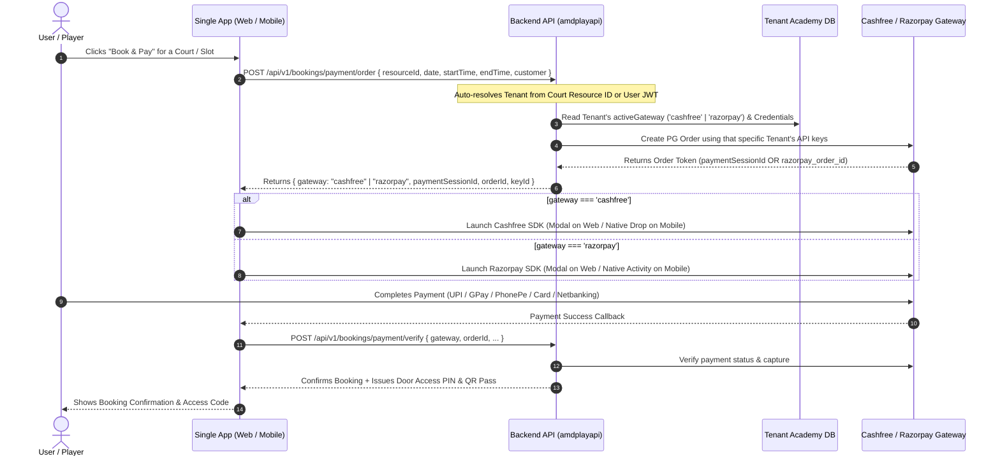

# Multi-Tenant Dual Payment Gateway Integration Guide (Cashfree + Razorpay)
## Single Application Codebase Supporting Multi-Academy Payment Routing

This guide provides the complete, production-ready integration pattern for a **single client application (Website & Mobile App)** operating across a **Multi-Tenant Sports Academy Platform**.

---

## 1. Problem Statement & Architecture

### The Requirement
* Your application serves multiple academies (tenants):
  * **Academy A** uses **Cashfree** $\rightarrow$ Funds settle into Academy A's Cashfree account.
  * **Academy B** uses **Razorpay** $\rightarrow$ Funds settle into Academy B's Razorpay account.
  * **Academy C** might switch between Razorpay and Cashfree at any time via Admin Settings.
* **The Goal**: The website and mobile app must **never hardcode** a payment gateway. A single checkout button must automatically invoke Cashfree or Razorpay depending on which academy / court is being booked.

### The Unified Workflow



---

## 2. Backend API Contract

Both Web and Mobile call the **exact same 2 endpoints**.

### Endpoint 1: Initialize Payment Order
* **URL**: `POST https://amdplayapi.amdtechno.in/api/v1/bookings/payment/order`
* **Headers**:
  ```http
  Content-Type: application/json
  Authorization: Bearer <OPTIONAL_USER_JWT_TOKEN>
  ```
  *(Works for logged-in students/members/coaches AND guest website visitors without a token).*

* **Request Body**:
  ```json
  {
    "resourceId": "68ea23c4a638b97dcf5e7912",
    "date": "2026-11-20",
    "startTime": "18:00",
    "endTime": "19:00",
    "customer": {
      "name": "Karthik Raja",
      "phone": "9876543210",
      "email": "karthik@example.com"
    },
    "returnUrl": "https://myapp.com/payment-status?order_id={order_id}"
  }
  ```

* **Response Scenario A (When Academy uses Cashfree)**:
  ```json
  {
    "success": true,
    "message": "Booking payment order initialized successfully",
    "data": {
      "gateway": "cashfree",
      "orderId": "cf_1794676500_1234",
      "cfOrderId": "10492812",
      "paymentSessionId": "session_6U58m3m2wQ99...",
      "amount": 354,
      "currency": "INR",
      "environment": "TEST",
      "pricing": {
        "basePrice": 300,
        "taxRate": 18,
        "taxAmount": 54,
        "totalAmount": 354
      }
    }
  }
  ```

* **Response Scenario B (When Academy uses Razorpay)**:
  ```json
  {
    "success": true,
    "message": "Booking payment order initialized successfully",
    "data": {
      "gateway": "razorpay",
      "orderId": "order_U08JJnFVeigYhA",
      "keyId": "rzp_live_xxxxxxxxxxxx",
      "amount": 354,
      "amountInPaise": 35400,
      "currency": "INR",
      "pricing": {
        "basePrice": 300,
        "taxRate": 18,
        "taxAmount": 54,
        "totalAmount": 354
      }
    }
  }
  ```

---

### Endpoint 2: Verify Payment & Confirm Booking
* **URL**: `POST https://amdplayapi.amdtechno.in/api/v1/bookings/payment/verify`
* **Headers**: `Content-Type: application/json`

* **Request Body (Cashfree)**:
  ```json
  {
    "gateway": "cashfree",
    "orderId": "cf_1794676500_1234",
    "resourceId": "68ea23c4a638b97dcf5e7912",
    "date": "2026-11-20",
    "startTime": "18:00",
    "endTime": "19:00",
    "name": "Karthik Raja",
    "phone": "9876543210",
    "email": "karthik@example.com"
  }
  ```

* **Request Body (Razorpay)**:
  ```json
  {
    "gateway": "razorpay",
    "razorpay_order_id": "order_U08JJnFVeigYhA",
    "razorpay_payment_id": "pay_29QQoUBcx96muk",
    "razorpay_signature": "9ef2bc4a89...",
    "resourceId": "68ea23c4a638b97dcf5e7912",
    "date": "2026-11-20",
    "startTime": "18:00",
    "endTime": "19:00",
    "name": "Karthik Raja",
    "phone": "9876543210",
    "email": "karthik@example.com"
  }
  ```

* **Success Response (Identical for Both Gateways)**:
  ```json
  {
    "success": true,
    "message": "Booking confirmed and payment verified successfully",
    "data": {
      "_id": "6901a9b23f81e4b3",
      "bookingNumber": "BK-20261120-41BC99",
      "status": "confirmed",
      "accessCode": "739201",
      "qrCodeUrl": "https://api.qrserver.com/v1/create-qr-code/?size=350x350&data=PIN%3A739201...",
      "pricing": {
        "basePrice": 300,
        "taxAmount": 54,
        "totalAmount": 354
      },
      "payment": {
        "method": "cashfree",
        "status": "success",
        "transactionId": "10492815"
      }
    }
  }
  ```

---

## 3. Website Integration (React, Next.js, Vue, or Plain JS)

### Step 1: Include Both SDKs in HTML
In your website's `index.html` (inside `<head>`):
```html
<!-- 1. Cashfree Web SDK v3 -->
<script src="https://sdk.cashfree.com/js/v3/cashfree.js"></script>

<!-- 2. Razorpay Web SDK v1 -->
<script src="https://checkout.razorpay.com/v1/checkout.js"></script>
```

Or install Cashfree via npm:
```bash
npm install @cashfreepayments/cashfree-js
```

---

### Step 2: Single Unified Checkout Function (JavaScript / TypeScript)

Save this file as `paymentService.js`:

```javascript
import { load } from '@cashfreepayments/cashfree-js';

const API_BASE_URL = 'https://amdplayapi.amdtechno.in/api/v1';

/**
 * Universal Multi-Tenant Checkout Handler
 * Handles both Cashfree and Razorpay automatically based on Academy Configuration.
 */
export async function executeBookingCheckout(bookingDetails, callbacks = {}) {
  const { onStart, onSuccess, onError, onCancel } = callbacks;

  if (onStart) onStart();

  try {
    const token = localStorage.getItem('token');
    const headers = { 'Content-Type': 'application/json' };
    if (token) headers['Authorization'] = `Bearer ${token}`;

    // -------------------------------------------------------------
    // 1. Initialize Order via Unified Endpoint
    // -------------------------------------------------------------
    const initResponse = await fetch(`${API_BASE_URL}/bookings/payment/order`, {
      method: 'POST',
      headers,
      body: JSON.stringify({
        resourceId: bookingDetails.resourceId,
        date: bookingDetails.date,
        startTime: bookingDetails.startTime,
        endTime: bookingDetails.endTime,
        slots: bookingDetails.slots, // Optional array if multi-slot
        customer: {
          name: bookingDetails.customerName || 'Player',
          phone: bookingDetails.customerPhone,
          email: bookingDetails.customerEmail || 'player@apexacademy.com',
        },
        returnUrl: `${window.location.origin}/booking-status?order_id={order_id}`,
      }),
    });

    const initResult = await initResponse.json();
    if (!initResult.success) {
      throw new Error(initResult.message || 'Failed to create payment order');
    }

    const orderData = initResult.data;
    const targetGateway = orderData.gateway; // "cashfree" or "razorpay"

    // -------------------------------------------------------------
    // 2A. Academy configured CASHFREE
    // -------------------------------------------------------------
    if (targetGateway === 'cashfree') {
      const isProduction = orderData.environment?.toLowerCase() === 'prod';
      const cashfree = await load({
        mode: isProduction ? 'production' : 'sandbox',
      });

      const cfResult = await cashfree.checkout({
        paymentSessionId: orderData.paymentSessionId,
        redirectTarget: '_modal', // Sleek popup modal inside the page
      });

      if (cfResult.error) {
        if (onCancel) onCancel(cfResult.error);
        return;
      }

      // Verify Cashfree
      const verifyRes = await fetch(`${API_BASE_URL}/bookings/payment/verify`, {
        method: 'POST',
        headers,
        body: JSON.stringify({
          gateway: 'cashfree',
          orderId: orderData.orderId,
          resourceId: bookingDetails.resourceId,
          date: bookingDetails.date,
          startTime: bookingDetails.startTime,
          endTime: bookingDetails.endTime,
          slots: bookingDetails.slots,
          name: bookingDetails.customerName,
          phone: bookingDetails.customerPhone,
          email: bookingDetails.customerEmail,
        }),
      });

      const verifyData = await verifyRes.json();
      if (verifyData.success) {
        if (onSuccess) onSuccess(verifyData.data);
      } else {
        throw new Error(verifyData.message || 'Payment verification failed');
      }
    }

    // -------------------------------------------------------------
    // 2B. Academy configured RAZORPAY
    // -------------------------------------------------------------
    else if (targetGateway === 'razorpay') {
      const options = {
        key: orderData.keyId,
        amount: orderData.amountInPaise,
        currency: 'INR',
        name: 'Sports Academy',
        description: `Court Booking: ${orderData.slot?.resourceName || 'Court'}`,
        order_id: orderData.orderId,
        prefill: {
          name: bookingDetails.customerName,
          contact: bookingDetails.customerPhone,
          email: bookingDetails.customerEmail,
        },
        theme: { color: '#2563EB' },
        handler: async (response) => {
          // Verify Razorpay
          try {
            const verifyRes = await fetch(`${API_BASE_URL}/bookings/payment/verify`, {
              method: 'POST',
              headers,
              body: JSON.stringify({
                gateway: 'razorpay',
                razorpay_order_id: response.razorpay_order_id,
                razorpay_payment_id: response.razorpay_payment_id,
                razorpay_signature: response.razorpay_signature,
                resourceId: bookingDetails.resourceId,
                date: bookingDetails.date,
                startTime: bookingDetails.startTime,
                endTime: bookingDetails.endTime,
                slots: bookingDetails.slots,
                name: bookingDetails.customerName,
                phone: bookingDetails.customerPhone,
                email: bookingDetails.customerEmail,
              }),
            });

            const verifyData = await verifyRes.json();
            if (verifyData.success) {
              if (onSuccess) onSuccess(verifyData.data);
            } else {
              throw new Error(verifyData.message || 'Payment verification failed');
            }
          } catch (err) {
            if (onError) onError(err);
          }
        },
        modal: {
          ondismiss: () => {
            if (onCancel) onCancel({ message: 'User closed payment window' });
          },
        },
      };

      const rzpInstance = new window.Razorpay(options);
      rzpInstance.open();
    }
  } catch (err) {
    if (onError) onError(err);
  }
}
```

---

### Step 3: React Button Example

```jsx
import React, { useState } from 'react';
import { executeBookingCheckout } from './paymentService';

export function CheckoutButton({ slotData }) {
  const [loading, setLoading] = useState(false);

  const handlePay = () => {
    executeBookingCheckout(
      {
        resourceId: slotData.resourceId,
        date: slotData.date,
        startTime: slotData.startTime,
        endTime: slotData.endTime,
        customerName: "Rahul Dravid",
        customerPhone: "9876543210",
        customerEmail: "rahul@example.com",
      },
      {
        onStart: () => setLoading(true),
        onSuccess: (booking) => {
          setLoading(false);
          alert(`Success! Booking #: ${booking.bookingNumber}\nYour Access PIN: ${booking.accessCode}`);
          window.location.href = `/confirmation?booking=${booking.bookingNumber}`;
        },
        onError: (err) => {
          setLoading(false);
          alert(`Payment Error: ${err.message}`);
        },
        onCancel: () => {
          setLoading(false);
        },
      }
    );
  };

  return (
    <button onClick={handlePay} disabled={loading} className="btn-primary">
      {loading ? 'Connecting Gateway...' : 'Pay & Confirm Slot'}
    </button>
  );
}
```

---

## 4. Mobile App Integration (Flutter Android & iOS)

A single Flutter mobile app handles both gateways natively.

### Step 1: Add Dependencies in `pubspec.yaml`
```yaml
dependencies:
  flutter:
    sdk: flutter
  http: ^1.2.0
  flutter_cashfree_pg_sdk: ^2.1.9  # Official Cashfree Flutter SDK
  razorpay_flutter: ^1.3.7         # Official Razorpay Flutter SDK
```
Run:
```bash
flutter pub get
```

---

### Step 2: Native Android & iOS Config

#### Android (`android/app/build.gradle` & `AndroidManifest.xml`)
In `android/app/build.gradle`:
```groovy
android {
    defaultConfig {
        minSdkVersion 21
    }
}
```

In `android/app/src/main/AndroidManifest.xml`:
```xml
<uses-permission android:name="android.permission.INTERNET"/>
```

#### iOS (`ios/Runner/Info.plist`)
Add UPI app URL schemes for seamless deep-linking to Google Pay, PhonePe, Paytm:
```xml
<key>LSApplicationQueriesSchemes</key>
<array>
    <string>phonepe</string>
    <string>tez</string>
    <string>paytmmp</string>
    <string>bhim</string>
</array>
```

---

### Step 3: Complete Unified Flutter Service Class

Save this file as `lib/services/unified_payment_service.dart`:

```dart
import 'dart:convert';
import 'package:flutter/material.dart';
import 'package:http/http.dart' as http;
import 'package:flutter_cashfree_pg_sdk/api/cfsession/cfsession.dart';
import 'package:flutter_cashfree_pg_sdk/api/cfpaymentgateway/cfpaymentgatewayservice.dart';
import 'package:flutter_cashfree_pg_sdk/api/cfdrop/cfdropcheckoutpayment.dart';
import 'package:flutter_cashfree_pg_sdk/utils/cfenums.dart';
import 'package:razorpay_flutter/razorpay_flutter.dart';

class UnifiedPaymentService {
  final CFPaymentGatewayService _cfService = CFPaymentGatewayService();
  late Razorpay _razorpay;

  final String apiBaseUrl = 'https://amdplayapi.amdtechno.in/api/v1';

  // State holders for active payment
  Map<String, dynamic>? _activeBookingData;
  String? _userToken;
  Function(Map<String, dynamic> booking)? _onSuccess;
  Function(String error)? _onError;

  UnifiedPaymentService() {
    _razorpay = Razorpay();
    _razorpay.on(Razorpay.EVENT_PAYMENT_SUCCESS, _handleRazorpaySuccess);
    _razorpay.on(Razorpay.EVENT_PAYMENT_ERROR, _handleRazorpayError);
    _razorpay.on(Razorpay.EVENT_EXTERNAL_WALLET, _handleRazorpayExternalWallet);
  }

  void dispose() {
    _razorpay.clear();
  }

  /// Master Payment Dispatcher
  Future<void> initiateBookingPayment({
    required BuildContext context,
    required Map<String, dynamic> bookingData,
    String? token,
    required Function(Map<String, dynamic> booking) onSuccess,
    required Function(String error) onError,
  }) async {
    _activeBookingData = bookingData;
    _userToken = token;
    _onSuccess = onSuccess;
    _onError = onError;

    try {
      final Map<String, String> headers = {'Content-Type': 'application/json'};
      if (token != null && token.isNotEmpty) {
        headers['Authorization'] = 'Bearer $token';
      }

      // 1. Initialize Order from Backend
      final response = await http.post(
        Uri.parse('$apiBaseUrl/bookings/payment/order'),
        headers: headers,
        body: jsonEncode(bookingData),
      );

      final Map<String, dynamic> result = jsonDecode(response.body);
      if (result['success'] != true) {
        onError(result['message'] ?? 'Failed to initialize payment');
        return;
      }

      final orderData = result['data'];
      final String gateway = orderData['gateway'] ?? 'razorpay';

      // -------------------------------------------------------------
      // 2A. Tenant uses CASHFREE
      // -------------------------------------------------------------
      if (gateway == 'cashfree') {
        _launchCashfreePayment(orderData);
      }
      // -------------------------------------------------------------
      // 2B. Tenant uses RAZORPAY
      // -------------------------------------------------------------
      else {
        _launchRazorpayPayment(orderData);
      }
    } catch (e) {
      onError('Payment error: $e');
    }
  }

  // --- Cashfree Mobile Flow ---
  void _launchCashfreePayment(Map<String, dynamic> orderData) {
    _cfService.setCallback(
      // Cashfree success callback
      (String orderId) async {
        await _verifyPayment({
          'gateway': 'cashfree',
          'orderId': orderId,
          ...?_activeBookingData,
        });
      },
      // Cashfree error callback
      (CFErrorResponse error, String orderId) {
        if (_onError != null) _onError!(error.getMessage() ?? 'Cashfree error');
      },
    );

    final bool isProd = (orderData['environment']?.toString().toUpperCase() == 'PROD');
    final CFSession session = CFSessionBuilder()
        .setEnvironment(isProd ? CFEnvironment.PRODUCTION : CFEnvironment.SANDBOX)
        .setOrderId(orderData['orderId'])
        .setPaymentSessionId(orderData['paymentSessionId'])
        .build();

    final CFDropCheckoutPayment cfPayment = CFDropCheckoutPaymentBuilder()
        .setSession(session)
        .build();

    _cfService.doPayment(cfPayment);
  }

  // --- Razorpay Mobile Flow ---
  void _launchRazorpayPayment(Map<String, dynamic> orderData) {
    final Map<String, dynamic> options = {
      'key': orderData['keyId'],
      'amount': orderData['amountInPaise'],
      'name': 'Sports Academy',
      'order_id': orderData['orderId'],
      'prefill': {
        'contact': _activeBookingData?['customer']?['phone'] ?? '',
        'email': _activeBookingData?['customer']?['email'] ?? '',
      },
    };

    _razorpay.open(options);
  }

  void _handleRazorpaySuccess(PaymentSuccessResponse response) async {
    await _verifyPayment({
      'gateway': 'razorpay',
      'razorpay_order_id': response.orderId,
      'razorpay_payment_id': response.paymentId,
      'razorpay_signature': response.signature,
      ...?_activeBookingData,
    });
  }

  void _handleRazorpayError(PaymentFailureResponse response) {
    if (_onError != null) {
      _onError!('Razorpay failed (${response.code}): ${response.message}');
    }
  }

  void _handleRazorpayExternalWallet(ExternalWalletResponse response) {}

  // --- Unified Backend Verification Call ---
  Future<void> _verifyPayment(Map<String, dynamic> verifyPayload) async {
    try {
      final Map<String, String> headers = {'Content-Type': 'application/json'};
      if (_userToken != null && _userToken!.isNotEmpty) {
        headers['Authorization'] = 'Bearer $_userToken';
      }

      final response = await http.post(
        Uri.parse('$apiBaseUrl/bookings/payment/verify'),
        headers: headers,
        body: jsonEncode(verifyPayload),
      );

      final Map<String, dynamic> verifyResult = jsonDecode(response.body);
      if (verifyResult['success'] == true) {
        if (_onSuccess != null) _onSuccess!(verifyResult['data']);
      } else {
        if (_onError != null) _onError!(verifyResult['message'] ?? 'Payment verification failed');
      }
    } catch (e) {
      if (_onError != null) _onError!('Verification connection error: $e');
    }
  }
}
```

---

### Step 4: Using the Service in a Flutter Screen

```dart
class BookingSummaryScreen extends StatefulWidget {
  final String courtId;
  final String date;
  final String startTime;
  final String endTime;

  const BookingSummaryScreen({
    Key? key,
    required this.courtId,
    required this.date,
    required this.startTime,
    required this.endTime,
  }) : super(key: key);

  @override
  State<BookingSummaryScreen> createState() => _BookingSummaryScreenState();
}

class _BookingSummaryScreenState extends State<BookingSummaryScreen> {
  final UnifiedPaymentService _paymentService = UnifiedPaymentService();
  bool _isLoading = false;

  @override
  void dispose() {
    _paymentService.dispose();
    super.dispose();
  }

  void _onPayPressed() {
    setState(() => _isLoading = true);

    _paymentService.initiateBookingPayment(
      context: context,
      bookingData: {
        'resourceId': widget.courtId,
        'date': widget.date,
        'startTime': widget.startTime,
        'endTime': widget.endTime,
        'customer': {
          'name': 'Karthik Raja',
          'phone': '9876543210',
          'email': 'karthik@example.com',
        },
      },
      onSuccess: (booking) {
        setState(() => _isLoading = false);
        showDialog(
          context: context,
          builder: (ctx) => AlertDialog(
            title: const Text('Booking Confirmed!'),
            content: Text(
              'Booking #: ${booking['bookingNumber']}\n\n'
              'Door Access PIN: ${booking['accessCode']}\n\n'
              'Court lights will turn ON 15 minutes before your slot.',
            ),
            actions: [
              TextButton(onPressed: () => Navigator.pop(ctx), child: const Text('Done'))
            ],
          ),
        );
      },
      onError: (errMsg) {
        setState(() => _isLoading = false);
        ScaffoldMessenger.of(context).showSnackBar(SnackBar(content: Text(errMsg)));
      },
    );
  }

  @override
  Widget build(BuildContext context) {
    return ElevatedButton(
      onPressed: _isLoading ? null : _onPayPressed,
      child: Text(_isLoading ? 'Processing...' : 'Pay & Confirm Slot'),
    );
  }
}
```

---

## 5. How Academy Admins Choose Gateway in Admin Panel

Each Tenant Academy Administrator can independently select and configure their payment gateway using the Settings API:

### Endpoint: `PATCH /api/v1/settings`
* **Headers**: `Authorization: Bearer <ADMIN_TOKEN>`

#### To activate Cashfree for Tenant A:
```json
{
  "paymentGateways": {
    "activeGateway": "cashfree",
    "cashfree": {
      "enabled": true,
      "appId": "CF_TENANT_A_APP_ID",
      "secretKey": "CF_TENANT_A_SECRET_KEY",
      "environment": "PROD"
    }
  }
}
```

#### To activate Razorpay for Tenant B:
```json
{
  "paymentGateways": {
    "activeGateway": "razorpay",
    "razorpay": {
      "enabled": true,
      "keyId": "rzp_live_TENANT_B_KEY_ID",
      "keySecret": "TENANT_B_KEY_SECRET"
    }
  }
}
```

---

## 6. Summary Checklist for Frontend & Mobile Teams

| Feature | Cashfree | Razorpay | Handled Dynamically? |
| :--- | :--- | :--- | :--- |
| **Backend Order URL** | `/api/v1/bookings/payment/order` | `/api/v1/bookings/payment/order` | Yes (Single Endpoint) |
| **Backend Verify URL** | `/api/v1/bookings/payment/verify` | `/api/v1/bookings/payment/verify` | Yes (Single Endpoint) |
| **Web Checkout Modal** | `@cashfreepayments/cashfree-js` | `checkout.razorpay.com/v1/checkout.js` | Yes (`if (gateway === 'cashfree') ... else ...`) |
| **Mobile App (Flutter)** | `flutter_cashfree_pg_sdk` | `razorpay_flutter` | Yes (`UnifiedPaymentService`) |
| **Bank Account Isolation** | Funds go to Tenant's Cashfree Account | Funds go to Tenant's Razorpay Account | Yes (Tenant API Keys are isolated) |
| **Guest Checkout (No Login)** | Fully Supported | Fully Supported | Yes (Tenant detected via Court ID) |
| **Door Access PIN Pass** | Auto-generated | Auto-generated | Yes (Same response payload) |
