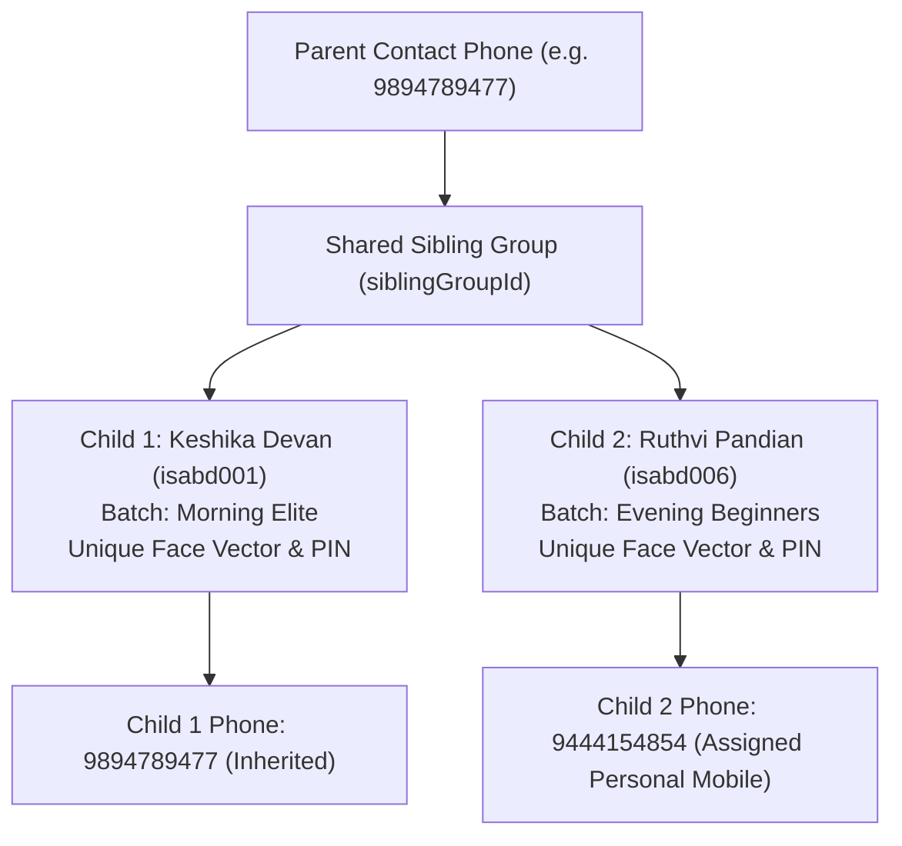
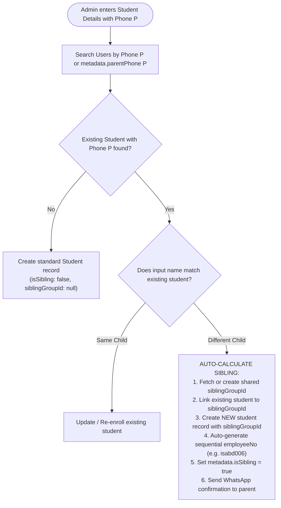

# 👨‍👩‍👦 Siblings & Family Management API - Complete Integration & Architecture Guide

> **Production API Base URL:** `https://www.amdplayapi.amdtechno.in/api/v1`  
> **Direct Host URL:** `https://amdplayapi.amdtechno.in/api/v1`  
> **Local Development URL:** `http://localhost:5005/api/v1`  
> **Swagger UI:** [https://www.amdplayapi.amdtechno.in/api/docs](https://www.amdplayapi.amdtechno.in/api/docs) *(Tag: `Students Management` / `Sibling Profiles`)*

---

## Table of Contents
1. [Architecture & System Design](#1-architecture--system-design)
2. [Auto-Calculation Engine (Registration Time)](#2-auto-calculation-engine-registration-time)
3. [Full Siblings CRUD API Specification](#3-full-siblings-crud-api-specification)
   - [Create: 1. Auto-Link on Student Onboarding](#create-1-auto-link-on-student-onboarding)
   - [Create: 2. Manual Sibling Linking (Master + New ID)](#create-2-manual-sibling-linking-master--new-id)
   - [Create: 3. Direct Sibling Link via Route Param](#create-3-direct-sibling-link-via-route-param)
   - [Read: 4. List All Sibling Families in Academy](#read-4-list-all-sibling-families-in-academy)
   - [Read: 5. Get Sibling Details for Specific Student](#read-5-get-sibling-details-for-specific-student)
   - [Read: 6. My Siblings (Mobile App Profile Switcher)](#read-6-my-siblings-mobile-app-profile-switcher)
   - [Update: 7. Assign Distinct Mobile Number to Sibling](#update-7-assign-distinct-mobile-number-to-sibling)
   - [Delete: 8. Unlink Student from Sibling Family](#delete-8-unlink-student-from-sibling-family)
4. [Database Schema & Data Model](#4-database-schema--data-model)
5. [Frontend & Mobile App Integration Guide](#5-frontend--mobile-app-integration-guide)
   - [Parent Single-Login & Multi-Child Switcher Flow](#parent-single-login--multi-child-switcher-flow)
   - [TypeScript Interfaces & Code Snippets](#typescript-interfaces--code-snippets)
6. [Live Curl Examples & Verification](#6-live-curl-examples--verification)

---

## 1. Architecture & System Design

In sports academies, parents frequently enroll **two or more children (siblings)** using the **same primary mobile number**. 

Traditional database designs with a unique constraint on phone numbers either fail or force staff to invent dummy phone numbers. The **AMD Sports SaaS Sibling Engine** provides a multi-profile architecture:



### Key Capabilities
1. **Zero Collision Multi-Profile**: Each sibling maintains an independent `_id`, distinct biometric `employeeNo` (e.g. `isabd001`, `isabd006`), distinct PIN/RFID credentials, separate batch schedules, attendance logs, coach evaluation scorecards, and monthly fee receipts.
2. **Auto-Calculation**: Registering a second or third student with the same phone or parent phone automatically detects the existing family, provisions a new student record, allocates/shares a `siblingGroupId`, and marks `isSibling: true`.
3. **Manual Sibling Linking**: If siblings were registered at different times or with different numbers, administrators can link them with just `masterStudentId` and `newStudentId`. All family contacts (`parentPhone`, `parentName`) and the `siblingGroupId` are auto-inherited from the master student.
4. **Distinct Mobile Assignment**: If an older child gets their own personal smartphone, administrators or coaches can assign them a personal mobile number without detaching them from the parent's sibling group or billing tree.
5. **Mobile Account Switcher**: When a parent logs in using their family mobile number, the mobile app retrieves all siblings via `/students/my/siblings` and enables 1-tap switching between children without logging out.

---

## 2. Auto-Calculation Engine (Registration Time)

When `POST /api/v1/students` or `POST /api/v1/coaching/register-student` is invoked, the backend executes the following auto-calculation workflow:



### Auto-Calculation Rules
1. If the existing student already has a `siblingGroupId`, the new student joins that exact group.
2. If the existing student does not yet have a `siblingGroupId`, a new `ObjectId` is created and assigned to **both** students atomically.
3. The parent phone and guardian name are synchronized across both profiles.
4. The response payload returns `isSibling: true` and the allocated `siblingGroupId`.

---

## 3. Full Siblings CRUD API Specification

### CREATE: 1. Auto-Link on Student Onboarding
Enrolling a new student with an existing parent phone triggers the auto-calculation engine.

- **Endpoint:** `POST /api/v1/students` *(or `POST /api/v1/coaching/register-student`)*
- **Headers:** `Authorization: Bearer <accessToken>`
- **Request Body:**
  ```json
  {
    "branchId": "6ad6bd7fd33a91a36c41ff46",
    "batchId": "6ae101a9185e913f71898555",
    "firstName": "Ruthvi",
    "lastName": "Pandian",
    "phone": "9894789477",
    "parentName": "Arunmozhidevan",
    "parentPhone": "9894789477",
    "skillLevel": "beginner",
    "monthlyFee": 2500
  }
  ```
- **Response (`201 Created`):**
  ```json
  {
    "success": true,
    "message": "Student registered and auto-linked to sibling family group successfully",
    "data": {
      "student": {
        "_id": "6af1e2ae185e913f71898a76",
        "name": "Ruthvi Pandian",
        "employeeNo": "isabd006",
        "phone": "9894789477",
        "siblingGroupId": "6af4929053cf12c1662f4b5a",
        "isSibling": true
      },
      "isSibling": true,
      "siblingGroupId": "6af4929053cf12c1662f4b5a"
    }
  }
  ```

---

### CREATE: 2. Manual Sibling Linking (Master + New ID)
Connects two existing students who were previously registered independently or with different mobile numbers.

> [!IMPORTANT]
> **No parent contacts are required in the payload!** The endpoint automatically inherits `siblingGroupId`, `parentPhone`, and `parentName` directly from the Master Student.

- **Endpoint:** `POST /api/v1/students/siblings` *(or `POST /api/v1/coaching/siblings`)*
- **Headers:** `Authorization: Bearer <accessToken>`
- **Request Body:**
  ```json
  {
    "masterStudentId": "6ae3bfa56989d6280874ef35",
    "newStudentId": "6af1e2ae185e913f71898a76"
  }
  ```
  *(Supported aliases: `studentId` / `primaryStudentId` for master; `siblingStudentId` / `siblingId` for new).*

- **Success Response (`200 OK`):**
  ```json
  {
    "success": true,
    "message": "Students linked into sibling family group successfully",
    "data": {
      "student": {
        "studentId": "6ae3bfa56989d6280874ef35",
        "fullName": "Keshika Devan",
        "regNo": "isabd001",
        "phone": "9894789477",
        "siblingGroupId": "6af4929053cf12c1662f4b5a"
      },
      "siblingCount": 1,
      "familyPhone": "9894789477",
      "parentName": "Arunmozhidevan",
      "siblings": [
        {
          "studentId": "6af1e2ae185e913f71898a76",
          "fullName": "RUTHVI PANDIAN",
          "regNo": "isabd006",
          "phone": "9444154854",
          "siblingGroupId": "6af4929053cf12c1662f4b5a"
        }
      ]
    }
  }
  ```

---

### CREATE: 3. Direct Sibling Link via Route Param
Convenience endpoint allowing linking by specifying the master student ID in the URL path.

- **Endpoint:** `POST /api/v1/students/:id/siblings`
- **Headers:** `Authorization: Bearer <accessToken>`
- **Request Body:**
  ```json
  {
    "newStudentId": "6af1e2ae185e913f71898a76"
  }
  ```

---

### READ: 4. List All Sibling Families in Academy
Returns all family clusters that contain 2 or more enrolled siblings, with aggregated student cards and pagination.

- **Endpoint:** `GET /api/v1/students/siblings` *(or `GET /api/v1/coaching/siblings`)*
- **Headers:** `Authorization: Bearer <accessToken>`
- **Query Parameters:**
  - `search` / `q` *(optional)*: Search by parent phone, guardian name, student name, or registration number (`isabd...`).
  - `branchId` *(optional)*: Filter by branch ID.
  - `page`: Page number (default: 1).
  - `limit`: Items per page (default: 20).
- **Success Response (`200 OK`):**
  ```json
  {
    "success": true,
    "message": "Sibling families retrieved successfully",
    "data": [
      {
        "siblingGroupId": "6af4929053cf12c1662f4b5a",
        "familyPhone": "9894789477",
        "parentName": "Arunmozhidevan",
        "studentCount": 2,
        "students": [
          {
            "id": "6ae3bfa56989d6280874ef35",
            "studentId": "6ae3bfa56989d6280874ef35",
            "fullName": "Keshika Devan",
            "regNo": "isabd001",
            "phone": "9894789477",
            "parentPhone": "9894789477",
            "parentName": "Arunmozhidevan",
            "batchName": "Badminton Morning Elite Stars",
            "status": "active"
          },
          {
            "id": "6af1e2ae185e913f71898a76",
            "studentId": "6af1e2ae185e913f71898a76",
            "fullName": "RUTHVI PANDIAN",
            "regNo": "isabd006",
            "phone": "9444154854",
            "parentPhone": "9894789477",
            "parentName": "Arunmozhidevan",
            "batchName": "Evening Badminton Stars",
            "status": "active"
          }
        ]
      }
    ],
    "pagination": {
      "page": 1,
      "limit": 20,
      "total": 1,
      "totalPages": 1
    }
  }
  ```

---

### READ: 5. Get Sibling Details for Specific Student
Fetches the full sibling roster and family contact details for a specific student.

- **Endpoint:** `GET /api/v1/students/:id/siblings` *(or `GET /api/v1/coaching/students/:id/siblings`)*
- **Headers:** `Authorization: Bearer <accessToken>`
- **Success Response (`200 OK`):**
  ```json
  {
    "success": true,
    "message": "Student sibling records retrieved successfully",
    "data": {
      "student": {
        "studentId": "6ae3bfa56989d6280874ef35",
        "fullName": "Keshika Devan",
        "regNo": "isabd001",
        "phone": "9894789477",
        "siblingGroupId": "6af4929053cf12c1662f4b5a"
      },
      "hasSiblings": true,
      "siblingCount": 1,
      "siblingGroupId": "6af4929053cf12c1662f4b5a",
      "familyPhone": "9894789477",
      "parentName": "Arunmozhidevan",
      "siblings": [
        {
          "studentId": "6af1e2ae185e913f71898a76",
          "fullName": "RUTHVI PANDIAN",
          "regNo": "isabd006",
          "phone": "9444154854",
          "siblingGroupId": "6af4929053cf12c1662f4b5a"
        }
      ]
    }
  }
  ```

---

### READ: 6. My Siblings (Mobile App Profile Switcher)
Used inside the Student / Parent Mobile App to show the family account switcher.

- **Endpoint:** `GET /api/v1/students/my/siblings`
- **Headers:** `Authorization: Bearer <accessToken>` *(Student / Parent token)*
- **Success Response (`200 OK`):**
  ```json
  {
    "success": true,
    "data": [
      {
        "studentId": "6af1e2ae185e913f71898a76",
        "fullName": "RUTHVI PANDIAN",
        "regNo": "isabd006",
        "phone": "9444154854",
        "siblingGroupId": "6af4929053cf12c1662f4b5a",
        "enrollments": [
          {
            "batchName": "Evening Badminton Stars",
            "schedule": {
              "startTime": "17:00",
              "endTime": "18:30"
            }
          }
        ]
      }
    ]
  }
  ```

---

### UPDATE: 7. Assign Distinct Mobile Number to Sibling
Updates an individual child's phone number without removing them from their sibling family group.

- **Endpoint:** `PATCH /api/v1/students/siblings/:id`  
  *(Aliases: `PATCH /api/v1/students/:id/phone` or `PATCH /api/v1/coaching/students/:id/sibling-phone`)*
- **Headers:** `Authorization: Bearer <accessToken>`
- **Request Body:**
  ```json
  {
    "phone": "9444154854",
    "parentPhone": "9894789477",
    "parentName": "Arunmozhidevan"
  }
  ```
  *(Note: `parentPhone` and `parentName` are optional; if omitted, they are preserved automatically).*

- **Success Response (`200 OK`):**
  ```json
  {
    "success": true,
    "message": "Sibling mobile number updated successfully while maintaining family group",
    "data": {
      "student": {
        "studentId": "6af1e2ae185e913f71898a76",
        "fullName": "RUTHVI PANDIAN",
        "phone": "9444154854",
        "parentPhone": "9894789477",
        "siblingGroupId": "6af4929053cf12c1662f4b5a"
      },
      "siblingCount": 1,
      "siblings": [
        {
          "studentId": "6ae3bfa56989d6280874ef35",
          "fullName": "Keshika Devan",
          "phone": "9894789477"
        }
      ]
    }
  }
  ```

---

### DELETE: 8. Unlink Student from Sibling Family
Detaches a student from their sibling group (e.g. if mistakenly linked). If only one student remains in the group, that student is also cleanly reset to single-student status.

- **Endpoint:** `DELETE /api/v1/students/siblings/:id`  
  *(Aliases: `DELETE /api/v1/students/:id/siblings` or `DELETE /api/v1/coaching/students/:id/siblings`)*
- **Headers:** `Authorization: Bearer <accessToken>`
- **Success Response (`200 OK`):**
  ```json
  {
    "success": true,
    "message": "Student unlinked from sibling group successfully",
    "data": {
      "studentId": "6af1e2ae185e913f71898a76"
    }
  }
  ```

---

## 4. Database Schema & Data Model

In MongoDB (Mongoose `User` collection), sibling relationships are indexed and managed via:

```typescript
// Mongoose User Schema Fields for Siblings
{
  tenantId: { type: ObjectId, required: true, index: true },
  role: { type: String, enum: ['student', ...], default: 'student' },
  phone: { type: String, index: true },
  
  // Dedicated Sibling Family Group ID (Shared across all siblings)
  siblingGroupId: { type: ObjectId, default: null, index: true },
  
  // Metadata Sibling Cache & Parent Details
  metadata: {
    siblingGroupId: { type: String, default: null },
    isSibling: { type: Boolean, default: false },
    parentName: { type: String, default: '' },
    parentPhone: { type: String, default: '', index: true },
    pin: { type: String },
    skillLevel: { type: String, default: 'beginner' }
  }
}
```

### Automatic Self-Healing Cleanup
When an unlinking operation leaves **only 1 student** in a `siblingGroupId`, the service automatically sets `siblingGroupId = null` and `isSibling = false` for that remaining student. No orphaned single-member groups exist in the database.

---

## 5. Frontend & Mobile App Integration Guide

### Parent Single-Login & Multi-Child Switcher Flow

1. **Login:** Parent logs into Mobile App with phone `9894789477` and password `Isa@123`.
2. **Retrieve Profiles:** Frontend calls `GET /api/v1/students/my/siblings`.
3. **If `siblings.length > 0`:** 
   - Show family profile pill at the top of the app:
     ```
     [ 👧 Keshika Devan (isabd001) ▼ ]
     ```
   - On tap, display the bottom sheet selector listing all children:
     - **Keshika Devan** • Badminton Morning Elite Stars
     - **Ruthvi Pandian** • Evening Badminton Stars
4. **Context Switch:** Switching the active child loads that child's attendance stats, coach evaluations radar scorecard, and monthly fee receipts instantly.

### TypeScript Interfaces & Code Snippets

```typescript
// Sibling Models Definition
export interface SiblingStudent {
  id: string;
  studentId: string;
  firstName: string;
  lastName?: string;
  fullName: string;
  phone: string;
  email?: string;
  regNo: string;
  employeeNo: string;
  cardNo?: string;
  pin?: string;
  siblingGroupId?: string;
  parentName?: string;
  parentPhone?: string;
  batchName?: string;
  status: 'active' | 'inactive';
}

export interface SiblingGroup {
  siblingGroupId: string;
  familyPhone: string;
  parentName: string;
  studentCount: number;
  students: SiblingStudent[];
}

export interface LinkSiblingsPayload {
  masterStudentId: string;
  newStudentId: string;
}

export interface AssignSiblingPhonePayload {
  phone: string;
  parentPhone?: string;
  parentName?: string;
}
```

#### React / Next.js Hook for Sibling Linking
```typescript
import { useState } from 'react';
import axios from 'axios';

export const useSiblings = (apiBaseUrl: string, token: string) => {
  const [loading, setLoading] = useState(false);

  // Link two students as siblings manually
  const linkSiblings = async (masterStudentId: string, newStudentId: string) => {
    setLoading(true);
    try {
      const response = await axios.post(
        `${apiBaseUrl}/students/siblings`,
        { masterStudentId, newStudentId },
        { headers: { Authorization: `Bearer ${token}` } }
      );
      return response.data;
    } finally {
      setLoading(false);
    }
  };

  // Assign distinct phone to a sibling
  const updateSiblingPhone = async (studentId: string, phone: string) => {
    setLoading(true);
    try {
      const response = await axios.patch(
        `${apiBaseUrl}/students/siblings/${studentId}`,
        { phone },
        { headers: { Authorization: `Bearer ${token}` } }
      );
      return response.data;
    } finally {
      setLoading(false);
    }
  };

  return { linkSiblings, updateSiblingPhone, loading };
};
```

---

## 6. Live Curl Examples & Verification

### 1. Link Two Existing Students as Siblings
```bash
curl -X POST "https://www.amdplayapi.amdtechno.in/api/v1/students/siblings" \
  -H "Authorization: Bearer <ADMIN_TOKEN>" \
  -H "Content-Type: application/json" \
  -d '{
    "masterStudentId": "6ae3bfa56989d6280874ef35",
    "newStudentId": "6af1e2ae185e913f71898a76"
  }'
```

### 2. List All Sibling Families with Search Keyword
```bash
curl -X GET "https://www.amdplayapi.amdtechno.in/api/v1/students/siblings?search=9894789477" \
  -H "Authorization: Bearer <ADMIN_TOKEN>"
```

### 3. Assign Separate Mobile to Sibling
```bash
curl -X PATCH "https://www.amdplayapi.amdtechno.in/api/v1/students/siblings/6af1e2ae185e913f71898a76" \
  -H "Authorization: Bearer <ADMIN_TOKEN>" \
  -H "Content-Type: application/json" \
  -d '{
    "phone": "9444154854"
  }'
```

### 4. Unlink Student from Sibling Family
```bash
curl -X DELETE "https://www.amdplayapi.amdtechno.in/api/v1/students/siblings/6af1e2ae185e913f71898a76" \
  -H "Authorization: Bearer <ADMIN_TOKEN>"
```

---
*Created for AMD Sports SaaS Platform - Production Sibling Architecture*

