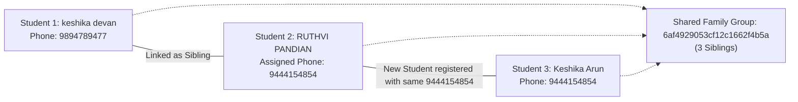

# 👨‍👩‍👦 Sibling API Specification & Frontend Integration Documentation

> **Base URL (Production HTTPS):** `https://www.amdplayapi.amdtechno.in/api/v1`  
> **Base URL (Direct Server):** `https://amdplayapi.amdtechno.in/api/v1`  
> **Base URL (Local Staging):** `http://localhost:5005/api/v1`  
> **Content-Type:** `application/json`  
> **Authentication:** `Authorization: Bearer <ACCESS_TOKEN>`  
> **Interactive Swagger UI:** [https://www.amdplayapi.amdtechno.in/api/docs](https://www.amdplayapi.amdtechno.in/api/docs) *(Tag: `Students Management` / `Sibling Profiles`)*

---

## Quick Endpoint Summary

| # | Action | Method | URL Path | Required Role |
|:---|:---|:---:|:---|:---|
| 1 | **Manual Link Existing Siblings** | `POST` | `/students/siblings` | `tenant_admin`, `branch_manager`, `coach` |
| 2 | **List All Sibling Families** | `GET` | `/students/siblings` | `tenant_admin`, `branch_manager`, `coach`, `staff` |
| 3 | **Get Sibling Records for Student** | `GET` | `/students/:id/siblings` | `tenant_admin`, `branch_manager`, `coach`, `student` |
| 4 | **My Siblings (Mobile App Switcher)** | `GET` | `/students/my/siblings` | `student`, `customer` |
| 5 | **Assign / Update Sibling Phone** | `PATCH` | `/students/siblings/:id` | `tenant_admin`, `branch_manager`, `coach` |
| 6 | **Unlink Student from Sibling Group** | `DELETE` | `/students/siblings/:id` | `tenant_admin`, `branch_manager`, `coach` |
| 7 | **Auto-Link on Registration** | `POST` | `/students` | `tenant_admin`, `branch_manager`, `coach` |

---

## 1. Manual Link Existing Students as Siblings

Links two already enrolled students into the same sibling family group.

> [!IMPORTANT]
> **No parent contacts are required in the payload!**  
> The system automatically inherits `siblingGroupId`, `parentPhone`, and `parentName` directly from the **Master Student** and assigns them to the new student.

### Request Details
- **Method:** `POST`
- **URL:** `https://www.amdplayapi.amdtechno.in/api/v1/students/siblings`
- **Headers:**
  ```http
  Authorization: Bearer <TOKEN>
  Content-Type: application/json
  ```

### Request Payload (JSON Body)
```json
{
  "masterStudentId": "6ae3bfa56989d6280874ef35",
  "newStudentId": "6af1e2ae185e913f71898a76"
}
```

#### Field Specifications

| Field | Type | Required | Description |
|:---|:---:|:---:|:---|
| `masterStudentId` | `string` (ObjectId) | **Yes** | Master / Primary Student User ID (whose group & family details will be inherited). |
| `newStudentId` | `string` (ObjectId) | **Yes** | New / Sibling Student User ID to link with the master student. |
| `studentId` | `string` (ObjectId) | *Optional* | Alias for `masterStudentId`. |
| `siblingStudentId`| `string` (ObjectId) | *Optional* | Alias for `newStudentId`. |

---

### Success Response (`200 OK`)
```json
{
  "success": true,
  "message": "Students linked into sibling family group successfully",
  "data": {
    "student": {
      "studentId": "6ae3bfa56989d6280874ef35",
      "fullName": "Keshika Devan",
      "regNo": "isabd001",
      "phone": "9894789477",
      "siblingGroupId": "6af4929053cf12c1662f4b5a"
    },
    "siblingCount": 1,
    "siblingGroupId": "6af4929053cf12c1662f4b5a",
    "familyPhone": "9894789477",
    "parentName": "Arunmozhidevan",
    "siblings": [
      {
        "studentId": "6af1e2ae185e913f71898a76",
        "fullName": "RUTHVI PANDIAN",
        "regNo": "isabd006",
        "phone": "9444154854",
        "siblingGroupId": "6af4929053cf12c1662f4b5a",
        "batchName": "Evening Badminton Stars",
        "status": "active"
      }
    ]
  }
}
```

### Error Responses
- **`400 Bad Request`**:
  ```json
  {
    "success": false,
    "error": {
      "code": "VALIDATION_ERROR",
      "message": "Both Master Student ID and New Student ID (masterStudentId and newStudentId) are required to link siblings"
    }
  }
  ```
- **`404 Not Found`**:
  ```json
  {
    "success": false,
    "error": {
      "code": "NOT_FOUND",
      "message": "One or more students not found in this academy"
    }
  }
  ```

---

## 2. List All Sibling Families in Academy

Returns all family groups that have 2 or more siblings, with aggregated student cards and pagination. Used to populate the **Sibling Families Table** in the Admin Panel.

### Request Details
- **Method:** `GET`
- **URL:** `https://www.amdplayapi.amdtechno.in/api/v1/students/siblings`
- **Headers:**
  ```http
  Authorization: Bearer <TOKEN>
  ```

### Query Parameters

| Parameter | Type | Required | Default | Description |
|:---|:---:|:---:|:---:|:---|
| `search` | `string` | No | - | Search keyword (matches Parent Name, Family Phone, Student Name, or Reg No e.g. `isabd001`). |
| `q` | `string` | No | - | Alias for `search`. |
| `branchId` | `string` | No | - | Filter by Branch ID. |
| `page` | `integer` | No | `1` | Page number. |
| `limit` | `integer` | No | `20` | Number of family groups per page. |

---

### Success Response (`200 OK`)
```json
{
  "success": true,
  "message": "Sibling families retrieved successfully",
  "data": [
    {
      "siblingGroupId": "6af4929053cf12c1662f4b5a",
      "familyPhone": "9894789477",
      "parentName": "Arunmozhidevan",
      "studentCount": 2,
      "students": [
        {
          "id": "6ae3bfa56989d6280874ef35",
          "studentId": "6ae3bfa56989d6280874ef35",
          "fullName": "Keshika Devan",
          "firstName": "Keshika",
          "lastName": "Devan",
          "regNo": "isabd001",
          "phone": "9894789477",
          "email": "keshika@example.com",
          "parentPhone": "9894789477",
          "parentName": "Arunmozhidevan",
          "batchId": "6ae101a9185e913f71898555",
          "batchName": "Badminton Morning Elite Stars",
          "status": "active"
        },
        {
          "id": "6af1e2ae185e913f71898a76",
          "studentId": "6af1e2ae185e913f71898a76",
          "fullName": "RUTHVI PANDIAN",
          "firstName": "RUTHVI",
          "lastName": "PANDIAN",
          "regNo": "isabd006",
          "phone": "9444154854",
          "email": "ruthvi@example.com",
          "parentPhone": "9894789477",
          "parentName": "Arunmozhidevan",
          "batchId": "6ae101a9185e913f71898777",
          "batchName": "Evening Badminton Stars",
          "status": "active"
        }
      ]
    }
  ],
  "pagination": {
    "page": 1,
    "limit": 20,
    "total": 1,
    "totalPages": 1
  }
}
```

---

## 3. Get Sibling Records for a Specific Student

Fetches the complete sibling roster, batch names, and guardian contact details for any selected student ID.

### Request Details
- **Method:** `GET`
- **URL:** `https://www.amdplayapi.amdtechno.in/api/v1/students/:id/siblings`
- **Headers:**
  ```http
  Authorization: Bearer <TOKEN>
  ```
- **URL Parameter:**
  - `:id` (`string`, required) = Student User ID (e.g. `6ae3bfa56989d6280874ef35`).

---

### Success Response (`200 OK`)
```json
{
  "success": true,
  "message": "Student sibling records retrieved successfully",
  "data": {
    "student": {
      "id": "6ae3bfa56989d6280874ef35",
      "studentId": "6ae3bfa56989d6280874ef35",
      "fullName": "Keshika Devan",
      "regNo": "isabd001",
      "phone": "9894789477",
      "siblingGroupId": "6af4929053cf12c1662f4b5a",
      "batchName": "Badminton Morning Elite Stars",
      "status": "active"
    },
    "hasSiblings": true,
    "siblingCount": 1,
    "siblingGroupId": "6af4929053cf12c1662f4b5a",
    "familyPhone": "9894789477",
    "parentName": "Arunmozhidevan",
    "siblings": [
      {
        "id": "6af1e2ae185e913f71898a76",
        "studentId": "6af1e2ae185e913f71898a76",
        "fullName": "RUTHVI PANDIAN",
        "regNo": "isabd006",
        "phone": "9444154854",
        "batchName": "Evening Badminton Stars",
        "siblingGroupId": "6af4929053cf12c1662f4b5a",
        "status": "active"
      }
    ]
  }
}
```

---

## 4. My Siblings (Mobile App Profile Switcher)

Used inside the Student & Parent Mobile App. When a parent logs in, this endpoint returns all sibling profiles enrolled under the parent's account to populate the **Profile Switcher bottom sheet**.

### Request Details
- **Method:** `GET`
- **URL:** `https://www.amdplayapi.amdtechno.in/api/v1/students/my/siblings`
- **Headers:**
  ```http
  Authorization: Bearer <STUDENT_OR_PARENT_TOKEN>
  ```

---

### Success Response (`200 OK`)
```json
{
  "success": true,
  "data": [
    {
      "id": "6af1e2ae185e913f71898a76",
      "studentId": "6af1e2ae185e913f71898a76",
      "firstName": "RUTHVI",
      "lastName": "PANDIAN",
      "fullName": "RUTHVI PANDIAN",
      "regNo": "isabd006",
      "employeeNo": "isabd006",
      "cardNo": "CARD98211",
      "phone": "9444154854",
      "siblingGroupId": "6af4929053cf12c1662f4b5a",
      "parentPhone": "9894789477",
      "enrollments": [
        {
          "_id": "6af1e2ae185e913f71898888",
          "batchId": {
            "_id": "6ae101a9185e913f71898777",
            "name": "Evening Badminton Stars",
            "schedule": {
              "daysOfWeek": [1, 3, 5],
              "startTime": "17:00",
              "endTime": "18:30"
            }
          },
          "status": "active"
        }
      ]
    }
  ]
}
```

---

## 5. Assign / Update Sibling Personal Mobile Number

Assigns or updates an individual mobile number for a specific child (e.g. child receives their own smartphone) while **safely keeping them in the family group** and preserving the parent's primary phone.

### Request Details
- **Method:** `PATCH`
- **URL:** `https://www.amdplayapi.amdtechno.in/api/v1/students/siblings/:id`
  - *(Alias URL: `https://www.amdplayapi.amdtechno.in/api/v1/students/:id/phone`)*
- **Headers:**
  ```http
  Authorization: Bearer <TOKEN>
  Content-Type: application/json
  ```
- **URL Parameter:**
  - `:id` (`string`, required) = Student ID whose mobile number is being updated.

### Request Payload (JSON Body)
```json
{
  "phone": "9444154854"
}
```

#### Optional Extended Payload
```json
{
  "phone": "9444154854",
  "parentPhone": "9894789477",
  "parentName": "Arunmozhidevan"
}
```

---

### Success Response (`200 OK`)
```json
{
  "success": true,
  "message": "Sibling mobile number updated successfully while maintaining family group",
  "data": {
    "student": {
      "studentId": "6af1e2ae185e913f71898a76",
      "fullName": "RUTHVI PANDIAN",
      "regNo": "isabd006",
      "phone": "9444154854",
      "parentPhone": "9894789477",
      "siblingGroupId": "6af4929053cf12c1662f4b5a"
    },
    "siblingCount": 1,
    "siblings": [
      {
        "studentId": "6ae3bfa56989d6280874ef35",
        "fullName": "Keshika Devan",
        "regNo": "isabd001",
        "phone": "9894789477",
        "siblingGroupId": "6af4929053cf12c1662f4b5a"
      }
    ]
  }
}
```

---

## 6. Unlink a Student from Sibling Group

Detaches a student from their family group (e.g., if two students were linked by mistake).

> [!NOTE]
> If unlinking leaves **only 1 student** remaining in the group, the system cleanly resets that remaining student to single-student status (`siblingGroupId = null`).

### Request Details
- **Method:** `DELETE`
- **URL:** `https://www.amdplayapi.amdtechno.in/api/v1/students/siblings/:id`
  - *(Alias URL: `https://www.amdplayapi.amdtechno.in/api/v1/students/:id/siblings`)*
- **Headers:**
  ```http
  Authorization: Bearer <TOKEN>
  ```
- **URL Parameter:**
  - `:id` (`string`, required) = Student ID to detach.

---

### Success Response (`200 OK`)
```json
{
  "success": true,
  "message": "Student unlinked from sibling group successfully",
  "data": {
    "studentId": "6af1e2ae185e913f71898a76"
  }
}
```

---

## 7. Auto-Link Sibling During Registration

When adding a new student through the standard registration endpoint, the backend checks if the phone matches an existing student. If so, it automatically provisions a new student record and links them into a shared sibling group.

### Request Details
- **Method:** `POST`
- **URL:** `https://www.amdplayapi.amdtechno.in/api/v1/students`
- **Headers:**
  ```http
  Authorization: Bearer <TOKEN>
  Content-Type: application/json
  ```

### Request Payload (JSON Body)
```json
{
  "branchId": "6ad6bd7fd33a91a36c41ff46",
  "batchId": "6ae101a9185e913f71898555",
  "sportId": "6ad6bd7fd33a91a36c41ff99",
  "firstName": "Ruthvi",
  "lastName": "Pandian",
  "phone": "9894789477",
  "parentName": "Arunmozhidevan",
  "parentPhone": "9894789477",
  "skillLevel": "beginner",
  "monthlyFee": 2500
}
```

---

### Success Response (`201 Created`)
```json
{
  "success": true,
  "message": "Student registered and auto-linked to sibling family group successfully",
  "data": {
    "student": {
      "_id": "6af1e2ae185e913f71898a76",
      "firstName": "Ruthvi",
      "lastName": "Pandian",
      "name": "Ruthvi Pandian",
      "phone": "9894789477",
      "employeeNo": "isabd006",
      "cardNo": "CARD98211",
      "pin": "491823",
      "siblingGroupId": "6af4929053cf12c1662f4b5a",
      "isSibling": true
    },
    "isSibling": true,
    "siblingGroupId": "6af4929053cf12c1662f4b5a",
    "enrollment": {
      "_id": "6af1e2ae185e913f71898888",
      "batchId": "6ae101a9185e913f71898555",
      "monthlyFee": 2500,
      "status": "active"
    }
  }
}
```

---

## 8. Summary of URL Aliases

Both `/students` and `/coaching` route prefixes are fully supported for backwards compatibility:

| Primary URL | Alias URL |
|:---|:---|
| `POST /api/v1/students/siblings` | `POST /api/v1/coaching/siblings` |
| `GET /api/v1/students/siblings` | `GET /api/v1/coaching/siblings` |
| `GET /api/v1/students/:id/siblings` | `GET /api/v1/coaching/students/:id/siblings` |
| `PATCH /api/v1/students/siblings/:id` | `PATCH /api/v1/students/:id/phone` & `PATCH /api/v1/coaching/students/:id/sibling-phone` |
| `DELETE /api/v1/students/siblings/:id` | `DELETE /api/v1/students/:id/siblings` & `DELETE /api/v1/coaching/students/:id/siblings` |

---

## 9. Why Multiple Students Appear Under the Same Family Group

### The Auto-Grouping Rule
Students belong to the same family group (`siblingGroupId`) in two ways:

1. **Direct Phone Link**:
   - Two students were registered with the exact same phone number or parent phone number (e.g. `9894789477`).
   - The system automatically assigns them a shared `siblingGroupId`.

2. **Transitive Chain via Sibling Phone Assignment**:
   - **Step A:** Student 1 (`keshika devan`, `9894789477`) and Student 2 (`RUTHVI PANDIAN`, `9894789477`) are linked under family group `6af4929053cf12c1662f4b5a`.
   - **Step B:** Student 2 (`RUTHVI PANDIAN`) is assigned their own personal phone number `9444154854` using `PATCH /students/siblings/:id`.
   - **Step C:** A new student, Student 3 (`Keshika Arun`), is registered with phone number `9444154854`.
   - **Result:** Because Student 3 was registered with `9444154854` (which belongs to Student 2 in family `6af4929053cf12c1662f4b5a`), the Auto-Calculation Engine assumes Student 3 is another child in Student 2's family and automatically places them into the same family group!



### How to Unlink / Separate a Student from the Family
If Student 3 (`Keshika Arun`) is **not** a sibling and should be independent:
- **API Call:**
  ```http
  DELETE https://www.amdplayapi.amdtechno.in/api/v1/students/siblings/6af4a0dfa04eca3b90eb24c3
  Authorization: Bearer <TOKEN>
  ```
- **Result:** Student 3 is immediately detached and removed from that family card, leaving only the genuine siblings in the group.

---
*Created for AMD Sports SaaS Platform - Sibling API Specification*
