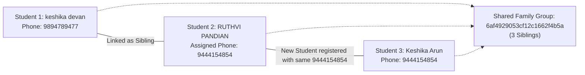
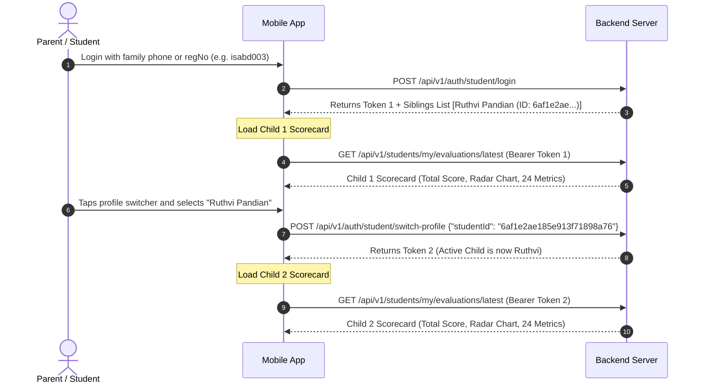

# 👨‍👩‍👦 Sibling API Specification & Frontend Integration Documentation

> **Base URL (Production HTTPS):** `https://www.amdplayapi.amdtechno.in/api/v1`  
> **Base URL (Direct Server):** `https://amdplayapi.amdtechno.in/api/v1`  
> **Base URL (Local Staging):** `http://localhost:5005/api/v1`  
> **Content-Type:** `application/json`  
> **Authentication:** `Authorization: Bearer <ACCESS_TOKEN>`  
> **Interactive Swagger UI:** [https://www.amdplayapi.amdtechno.in/api/docs](https://www.amdplayapi.amdtechno.in/api/docs) *(Tag: `Students Management` / `Sibling Profiles`)*

---

## Quick Endpoint Summary

| # | Action | Method | URL Path | Required Role |
|:---|:---|:---:|:---|:---|
| 1 | **Manual Link Existing Siblings** | `POST` | `/students/siblings` | `tenant_admin`, `branch_manager`, `coach` |
| 2 | **List All Sibling Families** | `GET` | `/students/siblings` | `tenant_admin`, `branch_manager`, `coach`, `staff` |
| 3 | **Get Sibling Records for Student** | `GET` | `/students/:id/siblings` | `tenant_admin`, `branch_manager`, `coach`, `student` |
| 4 | **My Siblings (Mobile App Switcher)** | `GET` | `/students/my/siblings` | `student`, `customer` |
| 5 | **Assign / Update Sibling Phone** | `PATCH` | `/students/siblings/:id` | `tenant_admin`, `branch_manager`, `coach` |
| 6 | **Unlink Student from Sibling Group** | `DELETE` | `/students/siblings/:id` | `tenant_admin`, `branch_manager`, `coach` |
| 7 | **Auto-Link on Registration** | `POST` | `/students` | `tenant_admin`, `branch_manager`, `coach` |
| 8 | **All Sibling Monthly Fees (Dashboard / Payments)** | `GET` | `/students/my/fees` | `student` |
| 9 | **Sibling-Wise Payments & Financial Breakdown** | `GET` | `/students/my/payments` | `student` |
| 10 | **Sibling Group Payments & Dues by Group/Phone** | `GET` | `/students/siblings/payments` | `tenant_admin`, `branch_manager`, `coach`, `student` |
| 11 | **Student & Siblings Scorecards** | `GET` | `/students/:id/evaluations/latest` | `tenant_admin`, `branch_manager`, `coach`, `student` |
| 12 | **Student & Sibling Attendance (Mobile Switcher)** | `GET` | `/students/my/attendance` | `student` |
| 13 | **Sibling Group Consolidated Attendance** | `GET` | `/students/siblings/attendance` | `tenant_admin`, `branch_manager`, `coach`, `student` |
| 14 | **Student & Sibling Full Profile (Mobile App)** | `GET` | `/students/my/profile` | `student`, `customer` |
| 15 | **Auth Session Profile with Sibling Context** | `GET` | `/auth/me` | `student`, `customer` |

---

## 1. Manual Link Existing Students as Siblings

Links two already enrolled students into the same sibling family group.

> [!IMPORTANT]
> **No parent contacts are required in the payload!**  
> The system automatically inherits `siblingGroupId`, `parentPhone`, and `parentName` directly from the **Master Student** and assigns them to the new student.

### Request Details
- **Method:** `POST`
- **URL:** `https://www.amdplayapi.amdtechno.in/api/v1/students/siblings`
- **Headers:**
  ```http
  Authorization: Bearer <TOKEN>
  Content-Type: application/json
  ```

### Request Payload (JSON Body)
```json
{
  "masterStudentId": "6ae3bfa56989d6280874ef35",
  "newStudentId": "6af1e2ae185e913f71898a76"
}
```

#### Field Specifications

| Field | Type | Required | Description |
|:---|:---:|:---:|:---|
| `masterStudentId` | `string` (ObjectId) | **Yes** | Master / Primary Student User ID (whose group & family details will be inherited). |
| `newStudentId` | `string` (ObjectId) | **Yes** | New / Sibling Student User ID to link with the master student. |
| `studentId` | `string` (ObjectId) | *Optional* | Alias for `masterStudentId`. |
| `siblingStudentId`| `string` (ObjectId) | *Optional* | Alias for `newStudentId`. |

---

### Success Response (`200 OK`)
```json
{
  "success": true,
  "message": "Students linked into sibling family group successfully",
  "data": {
    "student": {
      "studentId": "6ae3bfa56989d6280874ef35",
      "fullName": "Keshika Devan",
      "regNo": "isabd001",
      "phone": "9894789477",
      "siblingGroupId": "6af4929053cf12c1662f4b5a"
    },
    "siblingCount": 1,
    "siblingGroupId": "6af4929053cf12c1662f4b5a",
    "familyPhone": "9894789477",
    "parentName": "Arunmozhidevan",
    "siblings": [
      {
        "studentId": "6af1e2ae185e913f71898a76",
        "fullName": "RUTHVI PANDIAN",
        "regNo": "isabd006",
        "phone": "9444154854",
        "siblingGroupId": "6af4929053cf12c1662f4b5a",
        "batchName": "Evening Badminton Stars",
        "status": "active"
      }
    ]
  }
}
```

### Error Responses
- **`400 Bad Request`**:
  ```json
  {
    "success": false,
    "error": {
      "code": "VALIDATION_ERROR",
      "message": "Both Master Student ID and New Student ID (masterStudentId and newStudentId) are required to link siblings"
    }
  }
  ```
- **`404 Not Found`**:
  ```json
  {
    "success": false,
    "error": {
      "code": "NOT_FOUND",
      "message": "One or more students not found in this academy"
    }
  }
  ```

---

## 2. List All Sibling Families in Academy

Returns all family groups that have 2 or more siblings, with aggregated student cards and pagination. Used to populate the **Sibling Families Table** in the Admin Panel.

### Request Details
- **Method:** `GET`
- **URL:** `https://www.amdplayapi.amdtechno.in/api/v1/students/siblings`
- **Headers:**
  ```http
  Authorization: Bearer <TOKEN>
  ```

### Query Parameters

| Parameter | Type | Required | Default | Description |
|:---|:---:|:---:|:---:|:---|
| `search` | `string` | No | - | Search keyword (matches Parent Name, Family Phone, Student Name, or Reg No e.g. `isabd001`). |
| `q` | `string` | No | - | Alias for `search`. |
| `branchId` | `string` | No | - | Filter by Branch ID. |
| `page` | `integer` | No | `1` | Page number. |
| `limit` | `integer` | No | `20` | Number of family groups per page. |

---

### Success Response (`200 OK`)
```json
{
  "success": true,
  "message": "Sibling families retrieved successfully",
  "data": [
    {
      "siblingGroupId": "6af4929053cf12c1662f4b5a",
      "familyPhone": "9894789477",
      "parentName": "Arunmozhidevan",
      "studentCount": 2,
      "students": [
        {
          "id": "6ae3bfa56989d6280874ef35",
          "studentId": "6ae3bfa56989d6280874ef35",
          "fullName": "Keshika Devan",
          "firstName": "Keshika",
          "lastName": "Devan",
          "regNo": "isabd001",
          "phone": "9894789477",
          "email": "keshika@example.com",
          "parentPhone": "9894789477",
          "parentName": "Arunmozhidevan",
          "batchId": "6ae101a9185e913f71898555",
          "batchName": "Badminton Morning Elite Stars",
          "status": "active"
        },
        {
          "id": "6af1e2ae185e913f71898a76",
          "studentId": "6af1e2ae185e913f71898a76",
          "fullName": "RUTHVI PANDIAN",
          "firstName": "RUTHVI",
          "lastName": "PANDIAN",
          "regNo": "isabd006",
          "phone": "9444154854",
          "email": "ruthvi@example.com",
          "parentPhone": "9894789477",
          "parentName": "Arunmozhidevan",
          "batchId": "6ae101a9185e913f71898777",
          "batchName": "Evening Badminton Stars",
          "status": "active"
        }
      ]
    }
  ],
  "pagination": {
    "page": 1,
    "limit": 20,
    "total": 1,
    "totalPages": 1
  }
}
```

---

## 3. Get Sibling Records for a Specific Student

Fetches the complete sibling roster, batch names, and guardian contact details for any selected student ID.

### Request Details
- **Method:** `GET`
- **URL:** `https://www.amdplayapi.amdtechno.in/api/v1/students/:id/siblings`
- **Headers:**
  ```http
  Authorization: Bearer <TOKEN>
  ```
- **URL Parameter:**
  - `:id` (`string`, required) = Student User ID (e.g. `6ae3bfa56989d6280874ef35`).

---

### Success Response (`200 OK`)
```json
{
  "success": true,
  "message": "Student sibling records retrieved successfully",
  "data": {
    "student": {
      "id": "6ae3bfa56989d6280874ef35",
      "studentId": "6ae3bfa56989d6280874ef35",
      "fullName": "Keshika Devan",
      "regNo": "isabd001",
      "phone": "9894789477",
      "siblingGroupId": "6af4929053cf12c1662f4b5a",
      "batchName": "Badminton Morning Elite Stars",
      "status": "active"
    },
    "hasSiblings": true,
    "siblingCount": 1,
    "siblingGroupId": "6af4929053cf12c1662f4b5a",
    "familyPhone": "9894789477",
    "parentName": "Arunmozhidevan",
    "siblings": [
      {
        "id": "6af1e2ae185e913f71898a76",
        "studentId": "6af1e2ae185e913f71898a76",
        "fullName": "RUTHVI PANDIAN",
        "regNo": "isabd006",
        "phone": "9444154854",
        "batchName": "Evening Badminton Stars",
        "siblingGroupId": "6af4929053cf12c1662f4b5a",
        "status": "active"
      }
    ]
  }
}
```

---

## 4. My Siblings (Mobile App Profile Switcher)

Used inside the Student & Parent Mobile App. When a parent or student logs in, this endpoint returns **all sibling profiles** enrolled under the parent's account (including the logged-in student) to populate the **Profile Switcher bottom sheet** or sibling switcher pills.

> [!TIP]
> **Returns BOTH (All) Siblings!**  
> The endpoint returns all children in the family group.  
> The currently authenticated student has `isCurrent: true` and `isSelected: true`.  
> Sibling records have `isCurrent: false` and `isSelected: false`.  
> If you strictly need only the other siblings, pass query parameter `?excludeSelf=true`.

### Request Details
- **Method:** `GET`
- **URL:** `https://www.amdplayapi.amdtechno.in/api/v1/students/my/siblings`
- **Optional Query Parameters:**
  - `excludeSelf`: Pass `true` to omit the current logged-in user from the array.
- **Headers:**
  ```http
  Authorization: Bearer <STUDENT_OR_PARENT_TOKEN>
  ```

---

### Success Response (`200 OK`)
```json
{
  "success": true,
  "data": [
    {
      "id": "6af1e2ae185e913f71898a76",
      "studentId": "6af1e2ae185e913f71898a76",
      "_id": "6af1e2ae185e913f71898a76",
      "firstName": "RUTHVI",
      "lastName": "PANDIAN",
      "fullName": "RUTHVI PANDIAN",
      "regNo": "isabd006",
      "employeeNo": "isabd006",
      "cardNo": "445982",
      "phone": "9444154854",
      "siblingGroupId": "6af4929053cf12c1662f4b5a",
      "parentPhone": "9894789477",
      "parentName": "arunmozhidevan",
      "isCurrent": true,
      "isSelected": true,
      "enrollments": [
        {
          "_id": "6af1e2ae185e913f71898a7a",
          "batchId": {
            "_id": "6ae3be5a51203568f13cc0e5",
            "name": "kids_begineer",
            "code": "BEGINNER-0600",
            "sportId": {
              "_id": "6ad6bdead33a91a36c41ff5b",
              "name": "Badminton"
            }
          },
          "status": "active"
        }
      ]
    },
    {
      "id": "6ae3bfa56989d6280874ef35",
      "studentId": "6ae3bfa56989d6280874ef35",
      "_id": "6ae3bfa56989d6280874ef35",
      "firstName": "keshika",
      "lastName": "devan",
      "fullName": "keshika devan",
      "regNo": "isabd003",
      "employeeNo": "isabd003",
      "cardNo": "492116",
      "phone": "9894789477",
      "siblingGroupId": "6af4929053cf12c1662f4b5a",
      "parentPhone": "9894789477",
      "parentName": "arunmozhidevan",
      "isCurrent": false,
      "isSelected": false,
      "enrollments": [
        {
          "_id": "6ae3be5a51203568f13cc0e8",
          "batchId": {
            "_id": "6ae3be5a51203568f13cc0e5",
            "name": "kids_begineer",
            "code": "BEGINNER-0600",
            "sportId": {
              "_id": "6ad6bdead33a91a36c41ff5b",
              "name": "Badminton"
            }
          },
          "status": "active"
        }
      ]
    }
  ]
}
```

---

## 5. Assign / Update Sibling Personal Mobile Number

Assigns or updates an individual mobile number for a specific child (e.g. child receives their own smartphone) while **safely keeping them in the family group** and preserving the parent's primary phone.

### Request Details
- **Method:** `PATCH`
- **URL:** `https://www.amdplayapi.amdtechno.in/api/v1/students/siblings/:id`
  - *(Alias URL: `https://www.amdplayapi.amdtechno.in/api/v1/students/:id/phone`)*
- **Headers:**
  ```http
  Authorization: Bearer <TOKEN>
  Content-Type: application/json
  ```
- **URL Parameter:**
  - `:id` (`string`, required) = Student ID whose mobile number is being updated.

### Request Payload (JSON Body)
```json
{
  "phone": "9444154854"
}
```

#### Optional Extended Payload
```json
{
  "phone": "9444154854",
  "parentPhone": "9894789477",
  "parentName": "Arunmozhidevan"
}
```

---

### Success Response (`200 OK`)
```json
{
  "success": true,
  "message": "Sibling mobile number updated successfully while maintaining family group",
  "data": {
    "student": {
      "studentId": "6af1e2ae185e913f71898a76",
      "fullName": "RUTHVI PANDIAN",
      "regNo": "isabd006",
      "phone": "9444154854",
      "parentPhone": "9894789477",
      "siblingGroupId": "6af4929053cf12c1662f4b5a"
    },
    "siblingCount": 1,
    "siblings": [
      {
        "studentId": "6ae3bfa56989d6280874ef35",
        "fullName": "Keshika Devan",
        "regNo": "isabd001",
        "phone": "9894789477",
        "siblingGroupId": "6af4929053cf12c1662f4b5a"
      }
    ]
  }
}
```

---

## 6. Unlink a Student from Sibling Group

Detaches a student from their family group (e.g., if two students were linked by mistake).

> [!NOTE]
> If unlinking leaves **only 1 student** remaining in the group, the system cleanly resets that remaining student to single-student status (`siblingGroupId = null`).

### Request Details
- **Method:** `DELETE`
- **URL:** `https://www.amdplayapi.amdtechno.in/api/v1/students/siblings/:id`
  - *(Alias URL: `https://www.amdplayapi.amdtechno.in/api/v1/students/:id/siblings`)*
- **Headers:**
  ```http
  Authorization: Bearer <TOKEN>
  ```
- **URL Parameter:**
  - `:id` (`string`, required) = Student ID to detach.

---

### Success Response (`200 OK`)
```json
{
  "success": true,
  "message": "Student unlinked from sibling group successfully",
  "data": {
    "studentId": "6af1e2ae185e913f71898a76"
  }
}
```

---

## 7. Auto-Link Sibling During Registration

When adding a new student through the standard registration endpoint, the backend checks if the phone matches an existing student. If so, it automatically provisions a new student record and links them into a shared sibling group.

### Request Details
- **Method:** `POST`
- **URL:** `https://www.amdplayapi.amdtechno.in/api/v1/students`
- **Headers:**
  ```http
  Authorization: Bearer <TOKEN>
  Content-Type: application/json
  ```

### Request Payload (JSON Body)
```json
{
  "branchId": "6ad6bd7fd33a91a36c41ff46",
  "batchId": "6ae101a9185e913f71898555",
  "sportId": "6ad6bd7fd33a91a36c41ff99",
  "firstName": "Ruthvi",
  "lastName": "Pandian",
  "phone": "9894789477",
  "parentName": "Arunmozhidevan",
  "parentPhone": "9894789477",
  "skillLevel": "beginner",
  "monthlyFee": 2500
}
```

---

### Success Response (`201 Created`)
```json
{
  "success": true,
  "message": "Student registered and auto-linked to sibling family group successfully",
  "data": {
    "student": {
      "_id": "6af1e2ae185e913f71898a76",
      "firstName": "Ruthvi",
      "lastName": "Pandian",
      "name": "Ruthvi Pandian",
      "phone": "9894789477",
      "employeeNo": "isabd006",
      "cardNo": "CARD98211",
      "pin": "491823",
      "siblingGroupId": "6af4929053cf12c1662f4b5a",
      "isSibling": true
    },
    "isSibling": true,
    "siblingGroupId": "6af4929053cf12c1662f4b5a",
    "enrollment": {
      "_id": "6af1e2ae185e913f71898888",
      "batchId": "6ae101a9185e913f71898555",
      "monthlyFee": 2500,
      "status": "active"
    }
  }
}
```

---

## 8. Summary of URL Aliases

Both `/students` and `/coaching` route prefixes are fully supported for backwards compatibility:

| Primary URL | Alias URL |
|:---|:---|
| `POST /api/v1/students/siblings` | `POST /api/v1/coaching/siblings` |
| `GET /api/v1/students/siblings` | `GET /api/v1/coaching/siblings` |
| `GET /api/v1/students/:id/siblings` | `GET /api/v1/coaching/students/:id/siblings` |
| `PATCH /api/v1/students/siblings/:id` | `PATCH /api/v1/students/:id/phone` & `PATCH /api/v1/coaching/students/:id/sibling-phone` |
| `DELETE /api/v1/students/siblings/:id` | `DELETE /api/v1/students/:id/siblings` & `DELETE /api/v1/coaching/students/:id/siblings` |

---

## 9. Why Multiple Students Appear Under the Same Family Group

### The Auto-Grouping Rule
Students belong to the same family group (`siblingGroupId`) in two ways:

1. **Direct Phone Link**:
   - Two students were registered with the exact same phone number or parent phone number (e.g. `9894789477`).
   - The system automatically assigns them a shared `siblingGroupId`.

2. **Transitive Chain via Sibling Phone Assignment**:
   - **Step A:** Student 1 (`keshika devan`, `9894789477`) and Student 2 (`RUTHVI PANDIAN`, `9894789477`) are linked under family group `6af4929053cf12c1662f4b5a`.
   - **Step B:** Student 2 (`RUTHVI PANDIAN`) is assigned their own personal phone number `9444154854` using `PATCH /students/siblings/:id`.
   - **Step C:** A new student, Student 3 (`Keshika Arun`), is registered with phone number `9444154854`.
   - **Result:** Because Student 3 was registered with `9444154854` (which belongs to Student 2 in family `6af4929053cf12c1662f4b5a`), the Auto-Calculation Engine assumes Student 3 is another child in Student 2's family and automatically places them into the same family group!



### How to Unlink / Separate a Student from the Family
If Student 3 (`Keshika Arun`) is **not** a sibling and should be independent:
- **API Call:**
  ```http
  DELETE https://www.amdplayapi.amdtechno.in/api/v1/students/siblings/6af4a0dfa04eca3b90eb24c3
  Authorization: Bearer <TOKEN>
  ```
- **Result:** Student 3 is immediately detached and removed from that family card, leaving only the genuine siblings in the group.

---

## 10. How to Get Scorecards for Both Siblings in the Mobile App

When a parent or student logs into the Mobile App, here are the two standard methods to fetch and display evaluation scorecards for **BOTH** siblings:

---

### Method A: Seamless Profile Switcher (Recommended for Mobile App)

This is the primary flow used in the student mobile app. Tapping another child in the top profile switcher immediately switches the active session token, allowing all subsequent screens (Evaluations, Attendance, Monthly Fees) to automatically display that child's data.



#### Step 1: Login
- **Endpoint:** `POST https://www.amdplayapi.amdtechno.in/api/v1/auth/student/login`
- **Payload:**
  ```json
  {
    "identifier": "9894789477",
    "password": "Isa@123"
  }
  ```
- **Response (`200 OK`):**
  ```json
  {
    "success": true,
    "data": {
      "accessToken": "eyJhbGciOi...",
      "studentId": "6ae3bfa56989d6280874ef35",
      "user": {
        "firstName": "keshika",
        "regNo": "isabd003",
        "siblings": [
          {
            "studentId": "6af1e2ae185e913f71898a76",
            "fullName": "RUTHVI PANDIAN",
            "regNo": "isabd006"
          }
        ]
      }
    }
  }
  ```

#### Step 2: Fetch Child 1's Scorecard
- **Endpoint:** `GET https://www.amdplayapi.amdtechno.in/api/v1/students/my/evaluations/latest`
- **Headers:** `Authorization: Bearer <TOKEN_1>`

#### Step 3: Switch Active Child in Mobile App
When the parent selects the sibling (*"RUTHVI PANDIAN"*), call:
- **Endpoint:** `POST https://www.amdplayapi.amdtechno.in/api/v1/auth/student/switch-profile`
- **Headers:** `Authorization: Bearer <TOKEN_1>`, `Content-Type: application/json`
- **Payload:**
  ```json
  {
    "studentId": "6af1e2ae185e913f71898a76"
  }
  ```
  *(Note: `targetStudentId` is also supported as an alias).*
- **Response (`200 OK`):**
  ```json
  {
    "success": true,
    "message": "Switched to sibling student profile successfully",
    "data": {
      "accessToken": "eyJhbGciOi...NEW_TOKEN_FOR_RUTHVI...",
      "studentId": "6af1e2ae185e913f71898a76",
      "user": {
        "firstName": "RUTHVI",
        "lastName": "PANDIAN",
        "regNo": "isabd006"
      }
    }
  }
  ```

#### Step 4: Fetch Child 2's Scorecard
Using the new `accessToken` returned from Step 3:
- **Endpoint:** `GET https://www.amdplayapi.amdtechno.in/api/v1/students/my/evaluations/latest`
- **Headers:** `Authorization: Bearer <NEW_TOKEN_FOR_RUTHVI>`
- **Response (`200 OK`):** Returns Ruthvi's scorecard, 24 individual parameters, category scores, and radar stats.

---

### Method B: Direct Query by Student ID (Without Switching Token)

If the mobile app has a dashboard screen that wants to show **both scorecards side-by-side** simultaneously on the same screen:

- **Fetch Child 1 Scorecard:**
  ```http
  GET https://www.amdplayapi.amdtechno.in/api/v1/students/6ae3bfa56989d6280874ef35/evaluations/latest
  Authorization: Bearer <CURRENT_TOKEN>
  ```
- **Fetch Child 2 Scorecard:**
  ```http
  GET https://www.amdplayapi.amdtechno.in/api/v1/students/6af1e2ae185e913f71898a76/evaluations/latest
  Authorization: Bearer <CURRENT_TOKEN>
  ```

---

### Complete Scorecard Response Structure

```json
{
  "success": true,
  "message": "Latest evaluation report retrieved",
  "data": {
    "studentId": {
      "_id": "6af1e2ae185e913f71898a76",
      "firstName": "RUTHVI",
      "lastName": "PANDIAN",
      "employeeNo": "isabd006"
    },
    "batchId": {
      "name": "Evening Badminton Stars"
    },
    "title": "Coach Performance Assessment & Feedback",
    "evaluationDate": "2026-11-11",
    "period": "November 2026",
    "summary": {
      "overallScore": 191.5,
      "overallMaxScore": 240,
      "overallPercentage": 79.8,
      "performanceLevel": "Good",
      "grade": "B",
      "categoryScores": {
        "physical": { "score": 26, "maxScore": 50, "percentage": 52 },
        "mental": { "score": 43.5, "maxScore": 50, "percentage": 87 },
        "skill": { "score": 80, "maxScore": 80, "percentage": 100 },
        "attitude": { "score": 42, "maxScore": 60, "percentage": 70 }
      }
    },
    "radarData": [
      { "category": "Physical", "score": 26, "max": 50, "percentage": 52 },
      { "category": "Mental", "score": 43.5, "max": 50, "percentage": 87 },
      { "category": "Technical", "score": 80, "max": 80, "percentage": 100 },
      { "category": "Attitude", "score": 42, "max": 60, "percentage": 70 }
    ],
    "parameterCards": [
      { "key": "agility", "label": "Agility & Court Coverage", "score": 5, "maxScore": 10 },
      { "key": "smash", "label": "Smash Accuracy & Power", "score": 10, "maxScore": 10 }
    ],
    "coachRemarks": "Excellent technical execution; continue working on physical conditioning."
  }
}
```

---

## 11. How to Show All Fees for Both Siblings in Mobile App Dashboard

When parents or students switch between siblings in the dashboard (`Home` / `Payments`), the mobile app automatically receives **all fee records for all linked siblings in the family group**.

### Key Highlights
1. **Automatic Sibling Group Aggregation**:
   Calling `GET /api/v1/students/my/fees` automatically resolves the family's `siblingGroupId` or parent contact and fetches all invoices across both siblings.
2. **Seamless Profile Switch**:
   Whether the active session is **Keshika Devan** or shifted to **RUTHVI PANDIAN**, the same consolidated fee list is returned so the parent never misses an invoice.
3. **Child Identification on Mobile UI**:
   - For sibling families, `batchId.name` is automatically formatted as: `"<BatchName> (<Student FullName>)"` (e.g. `kids_begineer (keshika devan)` and `kids_begineer (RUTHVI PANDIAN)`). This renders directly inside existing Flutter mobile cards without requiring frontend layout changes.
   - Dedicated fields `studentName`, `studentRegNo`, `studentId`, and `student` object (`{ id, firstName, lastName, fullName, regNo, phone }`) are included on each fee object for custom multi-child UI tabs.
4. **1-Tap Online Payment for Any Sibling Invoice**:
   Parents can pay any pending sibling fee via Razorpay order endpoint (`POST /finance/monthly-fees/:id/razorpay/order`) or UPI without switching accounts.

---

### Request Details
- **Method:** `GET`
- **URL:** `https://www.amdplayapi.amdtechno.in/api/v1/students/my/fees`
- **Headers:**
  ```http
  Authorization: Bearer <STUDENT_OR_SIBLING_TOKEN>
  ```

*(Optional query alias: `GET https://www.amdplayapi.amdtechno.in/api/v1/students/:id/fees?includeSiblings=true`)*

---

### Success Response (`200 OK`)
```json
{
  "success": true,
  "message": "Personal monthly coaching fee records retrieved",
  "data": [
    {
      "_id": "6af1e2ae185e913f71898a7e",
      "studentId": "6af1e2ae185e913f71898a76",
      "studentName": "RUTHVI PANDIAN",
      "studentRegNo": "isabd006",
      "student": {
        "_id": "6af1e2ae185e913f71898a76",
        "id": "6af1e2ae185e913f71898a76",
        "studentId": "6af1e2ae185e913f71898a76",
        "firstName": "RUTHVI",
        "lastName": "PANDIAN",
        "fullName": "RUTHVI PANDIAN",
        "regNo": "isabd006",
        "employeeNo": "isabd006",
        "phone": "9444154854"
      },
      "month": 11,
      "year": 2026,
      "baseFee": 2500,
      "discountAmount": 0,
      "finalAmount": 2500,
      "paidAmount": 2500,
      "dueDate": "2026-11-04T18:30:00.000Z",
      "status": "paid",
      "paidAt": "2026-11-11T20:25:02.474Z",
      "receiptNo": "REC-STU-202611-7129",
      "batchName": "kids_begineer",
      "batchId": {
        "_id": "6ae3be5a51203568f13cc0e5",
        "name": "kids_begineer (RUTHVI PANDIAN)",
        "batchName": "kids_begineer",
        "code": "BEGINNER-0600",
        "schedule": {
          "daysOfWeek": [1, 3, 5],
          "startTime": "06:00",
          "endTime": "07:00"
        }
      },
      "sportId": {
        "_id": "6ad6bdead33a91a36c41ff5b",
        "name": "Badminton",
        "icon": ""
      }
    },
    {
      "_id": "6ae535a941a64984822e1c89",
      "studentId": "6ae3bfa56989d6280874ef35",
      "studentName": "keshika devan",
      "studentRegNo": "isabd003",
      "student": {
        "_id": "6ae3bfa56989d6280874ef35",
        "id": "6ae3bfa56989d6280874ef35",
        "studentId": "6ae3bfa56989d6280874ef35",
        "firstName": "keshika",
        "lastName": "devan",
        "fullName": "keshika devan",
        "regNo": "isabd003",
        "employeeNo": "isabd003",
        "phone": "9894789477"
      },
      "month": 11,
      "year": 2026,
      "baseFee": 2500,
      "discountAmount": 0,
      "finalAmount": 2500,
      "paidAmount": 2500,
      "dueDate": "2026-11-04T18:30:00.000Z",
      "status": "paid",
      "paidAt": "2026-11-11T20:25:02.474Z",
      "receiptNo": "REC-STU-202611-7128",
      "batchName": "kids_begineer",
      "batchId": {
        "_id": "6ae3be5a51203568f13cc0e5",
        "name": "kids_begineer (keshika devan)",
        "batchName": "kids_begineer",
        "code": "BEGINNER-0600",
        "schedule": {
          "daysOfWeek": [1, 3, 5],
          "startTime": "06:00",
          "endTime": "07:00"
        }
      },
      "sportId": {
        "_id": "6ad6bdead33a91a36c41ff5b",
        "name": "Badminton",
        "icon": ""
      }
    },
    {
      "_id": "6ae532e1b2d71308812c19f1",
      "studentId": "6ae3bfa56989d6280874ef35",
      "studentName": "keshika devan",
      "studentRegNo": "isabd003",
      "student": {
        "_id": "6ae3bfa56989d6280874ef35",
        "id": "6ae3bfa56989d6280874ef35",
        "studentId": "6ae3bfa56989d6280874ef35",
        "firstName": "keshika",
        "lastName": "devan",
        "fullName": "keshika devan",
        "regNo": "isabd003",
        "employeeNo": "isabd003",
        "phone": "9894789477"
      },
      "month": 10,
      "year": 2026,
      "baseFee": 2500,
      "discountAmount": 0,
      "finalAmount": 2500,
      "paidAmount": 2500,
      "dueDate": "2026-10-04T18:30:00.000Z",
      "status": "paid",
      "paidAt": "2026-10-31T20:25:02.474Z",
      "receiptNo": "REC-STU-202610-5201",
      "batchName": "kids_begineer",
      "batchId": {
        "_id": "6ae3be5a51203568f13cc0e5",
        "name": "kids_begineer (keshika devan)",
        "batchName": "kids_begineer",
        "code": "BEGINNER-0600",
        "schedule": {
          "daysOfWeek": [1, 3, 5],
          "startTime": "06:00",
          "endTime": "07:00"
        }
      },
      "sportId": {
        "_id": "6ad6bdead33a91a36c41ff5b",
        "name": "Badminton",
        "icon": ""
      }
    }
  ]
}
```

---

## 12. Sibling-Wise Payments & Fee Financial Breakdown for Mobile App

For mobile screens (e.g. **Payments Tab**, **Sibling Fee Cards**, or **Parent Billing Summary**), this endpoint delivers a fully aggregated, child-by-child financial breakdown for the entire family.

### Key Capabilities
1. **Per-Child Financial Summaries**:
   - Each sibling card includes their own `summary`: `totalAmount`, `totalPaid`, `totalPending`, `invoiceCount`, `paidCount`, and `pendingCount`.
2. **Dedicated Fee Invoices & Payment Receipts per Child**:
   - Under each sibling object, `fees` holds all monthly invoices (pending, overdue, paid) and `payments` holds all verified ledger transactions/receipts for that child.
3. **Family Overview**:
   - Top-level `summary` aggregates the total family obligation, paid amount, pending balance, and total transactions across all siblings.
4. **Zero-Configuration Calling**:
   - When calling with any active student/parent Bearer token, the system automatically detects all linked siblings in the family group.

---

### Available Endpoints & Methods

| # | Endpoint URL | Method | Description |
|---|---|:---:|---|
| **A** | `https://www.amdplayapi.amdtechno.in/api/v1/students/my/payments` | `GET` | **Recommended**: Direct sibling-wise payments breakdown for logged-in student/parent session |
| **B** | `https://www.amdplayapi.amdtechno.in/api/v1/students/my/fees?groupBy=sibling` | `GET` | Sibling-wise grouped format on the standard `/my/fees` route |
| **C** | `https://www.amdplayapi.amdtechno.in/api/v1/students/siblings/payments` | `GET` | Family lookup by `?studentId=...`, `?familyPhone=...`, or `?siblingGroupId=...` |
| **D** | `https://www.amdplayapi.amdtechno.in/api/v1/students/:id/payments` | `GET` | Specific student payment history with family siblings breakdown |

---

### Request Details
- **Method:** `GET`
- **URL:** `https://www.amdplayapi.amdtechno.in/api/v1/students/my/payments`
- **Headers:**
  ```http
  Authorization: Bearer <TOKEN>
  ```

---

### Success Response (`200 OK`)

```json
{
  "success": true,
  "message": "Personal and sibling payment records retrieved successfully",
  "data": {
    "familyPhone": "9894789477",
    "parentName": "arunmozhidevan",
    "siblingGroupId": "6af4929053cf12c1662f4b5a",
    "totalStudents": 2,
    "summary": {
      "totalAmount": 7500,
      "totalPaid": 7500,
      "totalPending": 0,
      "totalInvoices": 3,
      "paidInvoices": 3,
      "pendingInvoices": 0,
      "paymentTransactions": 3
    },
    "siblings": [
      {
        "studentId": "6ae3bfa56989d6280874ef35",
        "_id": "6ae3bfa56989d6280874ef35",
        "firstName": "keshika",
        "lastName": "devan",
        "fullName": "keshika devan",
        "regNo": "isabd003",
        "employeeNo": "isabd003",
        "phone": "9894789477",
        "parentPhone": "9894789477",
        "parentName": "arunmozhidevan",
        "summary": {
          "totalAmount": 5000,
          "totalPaid": 5000,
          "totalPending": 0,
          "invoiceCount": 2,
          "paidCount": 2,
          "pendingCount": 0,
          "paymentTransactionCount": 2
        },
        "fees": [
          {
            "_id": "6ae535a941a64984822e1c89",
            "studentId": "6ae3bfa56989d6280874ef35",
            "studentName": "keshika devan",
            "studentRegNo": "isabd003",
            "month": 11,
            "year": 2026,
            "baseFee": 2500,
            "finalAmount": 2500,
            "paidAmount": 2500,
            "status": "paid",
            "receiptNo": "REC-STU-202611-7128",
            "paidAt": "2026-11-11T20:25:02.474Z",
            "batchName": "kids_begineer",
            "batchDisplayName": "kids_begineer (keshika devan)",
            "batchId": {
              "_id": "6ae3be5a51203568f13cc0e5",
              "name": "kids_begineer"
            },
            "sportId": {
              "_id": "6ad6bdead33a91a36c41ff5b",
              "name": "Badminton"
            }
          },
          {
            "_id": "6ae532e1b2d71308812c19f1",
            "studentId": "6ae3bfa56989d6280874ef35",
            "studentName": "keshika devan",
            "studentRegNo": "isabd003",
            "month": 10,
            "year": 2026,
            "baseFee": 2500,
            "finalAmount": 2500,
            "paidAmount": 2500,
            "status": "paid",
            "receiptNo": "REC-STU-202610-5201",
            "paidAt": "2026-10-31T20:25:02.474Z",
            "batchName": "kids_begineer",
            "batchDisplayName": "kids_begineer (keshika devan)",
            "batchId": {
              "_id": "6ae3be5a51203568f13cc0e5",
              "name": "kids_begineer"
            },
            "sportId": {
              "_id": "6ad6bdead33a91a36c41ff5b",
              "name": "Badminton"
            }
          }
        ],
        "payments": [
          {
            "_id": "6af4cf1ea04eca3b90eb2d16",
            "studentId": "6ae3bfa56989d6280874ef35",
            "studentName": "keshika devan",
            "studentRegNo": "isabd003",
            "amount": 2500,
            "currency": "INR",
            "type": "coaching",
            "paymentMethod": "upi",
            "status": "success",
            "referenceId": "6ae535a941a64984822e1c89",
            "createdAt": "2026-11-11T20:25:02.474Z"
          },
          {
            "_id": "6af4cf3ca04eca3b90eb2d3a",
            "studentId": "6ae3bfa56989d6280874ef35",
            "studentName": "keshika devan",
            "studentRegNo": "isabd003",
            "amount": 2500,
            "currency": "INR",
            "type": "coaching",
            "paymentMethod": "upi",
            "status": "success",
            "referenceId": "6ae532e1b2d71308812c19f1",
            "createdAt": "2026-10-31T20:25:02.474Z"
          }
        ]
      },
      {
        "studentId": "6af1e2ae185e913f71898a76",
        "_id": "6af1e2ae185e913f71898a76",
        "firstName": "RUTHVI",
        "lastName": "PANDIAN",
        "fullName": "RUTHVI PANDIAN",
        "regNo": "isabd006",
        "employeeNo": "isabd006",
        "phone": "9444154854",
        "parentPhone": "9894789477",
        "parentName": "arunmozhidevan",
        "summary": {
          "totalAmount": 2500,
          "totalPaid": 2500,
          "totalPending": 0,
          "invoiceCount": 1,
          "paidCount": 1,
          "pendingCount": 0,
          "paymentTransactionCount": 1
        },
        "fees": [
          {
            "_id": "6af1e2ae185e913f71898a7e",
            "studentId": "6af1e2ae185e913f71898a76",
            "studentName": "RUTHVI PANDIAN",
            "studentRegNo": "isabd006",
            "month": 11,
            "year": 2026,
            "baseFee": 2500,
            "finalAmount": 2500,
            "paidAmount": 2500,
            "status": "paid",
            "receiptNo": "REC-STU-202611-7129",
            "paidAt": "2026-11-11T20:25:02.474Z",
            "batchName": "kids_begineer",
            "batchDisplayName": "kids_begineer (RUTHVI PANDIAN)",
            "batchId": {
              "_id": "6ae3be5a51203568f13cc0e5",
              "name": "kids_begineer"
            },
            "sportId": {
              "_id": "6ad6bdead33a91a36c41ff5b",
              "name": "Badminton"
            }
          }
        ],
        "payments": [
          {
            "_id": "6af1e37a185e913f71898ad7",
            "studentId": "6af1e2ae185e913f71898a76",
            "studentName": "RUTHVI PANDIAN",
            "studentRegNo": "isabd006",
            "amount": 2500,
            "currency": "INR",
            "type": "coaching",
            "paymentMethod": "upi",
            "status": "success",
            "referenceId": "6af1e2ae185e913f71898a7e",
            "createdAt": "2026-11-11T20:25:02.474Z"
          }
        ]
      }
    ]
  }
}
```

---

## 13. Student & Sibling Attendance (Mobile App Profile Switcher)

Retrieves personal and sibling attendance statistics, biometric punch logs, and coach session records for the logged-in student or parent.

> [!TIP]
> **Zero Re-Authentication Required!**  
> Parents with multiple children can switch between sibling attendance histories simply by passing `?studentId=<siblingId>`.  
> The endpoint automatically validates family group membership and updates `isSelected` accordingly.

### Request Details
- **Method:** `GET`
- **URL Path:** `/api/v1/students/my/attendance`
- **Optional Query Parameters:**
  - `studentId`: Switch to attendance for a specific sibling (e.g. `?studentId=6ae3bfa56989d6280874ef35`)
  - `groupBy`: Set to `sibling` for whole-family attendance breakdown (e.g. `?groupBy=sibling`)
  - `format`: Alias for `groupBy` (`grouped` or `sibling`)
- **Headers:**
  ```http
  Authorization: Bearer <STUDENT_OR_PARENT_TOKEN>
  x-tenant-id: <TENANT_ID>
  ```

---

### Success Response (`200 OK`) — Default / Sibling Switcher View

```json
{
  "success": true,
  "message": "Personal and sibling attendance records retrieved",
  "data": {
    "studentId": "6af1e2ae185e913f71898a76",
    "studentName": "RUTHVI PANDIAN",
    "regNo": "isabd006",
    "employeeNo": "isabd006",
    "batchId": "6ae3be5a51203568f13cc0e5",
    "batchName": "kids_begineer",
    "sportName": "Badminton",
    "totalSessions": 12,
    "presentCount": 11,
    "absentCount": 1,
    "excusedCount": 0,
    "attendancePercentage": 92,
    "punchLogs": [
      {
        "_id": "6af6bea6f59f66dbc7bb91c8",
        "studentId": "6af1e2ae185e913f71898a76",
        "studentName": "RUTHVI PANDIAN",
        "punchTime": "2026-11-13T07:39:18.000Z",
        "verificationMode": "face",
        "deviceName": "ISA_BADMINTON_ACCESS",
        "deviceCode": "DEV-ISA-ACCESS",
        "status": "verified"
      }
    ],
    "sessionHistory": [
      {
        "date": "2026-11-12",
        "batchId": "6ae3be5a51203568f13cc0e5",
        "status": "present",
        "remarks": "IN: 07:00 AM | OUT: 08:00 AM (60m, FACE)",
        "verificationMode": "face"
      }
    ],
    "hasSiblings": true,
    "siblingCount": 1,
    "siblingGroupId": "6af4929053cf12c1662f4b5a",
    "familyPhone": "9444154854",
    "parentName": "ARUNMOZHIDEVAN",
    "selectedStudent": {
      "studentId": "6af1e2ae185e913f71898a76",
      "fullName": "RUTHVI PANDIAN",
      "firstName": "RUTHVI",
      "lastName": "PANDIAN",
      "regNo": "isabd006",
      "phone": "9444154854",
      "cardNo": "445982",
      "avatar": "",
      "batchName": "kids_begineer",
      "sportName": "Badminton",
      "attendancePercentage": 92,
      "totalSessions": 12,
      "presentCount": 11,
      "absentCount": 1
    },
    "siblings": [
      {
        "studentId": "6af1e2ae185e913f71898a76",
        "_id": "6af1e2ae185e913f71898a76",
        "firstName": "RUTHVI",
        "lastName": "PANDIAN",
        "fullName": "RUTHVI PANDIAN",
        "employeeNo": "isabd006",
        "regNo": "isabd006",
        "phone": "9444154854",
        "cardNo": "445982",
        "avatar": "",
        "batchId": "6ae3be5a51203568f13cc0e5",
        "batchName": "kids_begineer",
        "sportName": "Badminton",
        "totalSessions": 12,
        "presentCount": 11,
        "absentCount": 1,
        "excusedCount": 0,
        "attendancePercentage": 92,
        "latestPunch": {
          "punchTime": "2026-11-13T07:39:18.000Z",
          "verificationMode": "face",
          "deviceName": "ISA_BADMINTON_ACCESS",
          "deviceCode": "DEV-ISA-ACCESS",
          "status": "verified"
        },
        "isSelected": true
      },
      {
        "studentId": "6ae3bfa56989d6280874ef35",
        "_id": "6ae3bfa56989d6280874ef35",
        "firstName": "keshika",
        "lastName": "devan",
        "fullName": "keshika devan",
        "employeeNo": "isabd003",
        "regNo": "isabd003",
        "phone": "9894789477",
        "cardNo": "492116",
        "avatar": "",
        "batchId": "6ae3be5a51203568f13cc0e5",
        "batchName": "kids_begineer",
        "sportName": "Badminton",
        "totalSessions": 14,
        "presentCount": 13,
        "absentCount": 1,
        "excusedCount": 0,
        "attendancePercentage": 93,
        "latestPunch": null,
        "isSelected": false
      }
    ]
  }
}
```

---

### Success Response (`200 OK`) — Grouped View (`?groupBy=sibling`)

```json
{
  "success": true,
  "message": "Personal and sibling attendance records retrieved",
  "data": {
    "siblingGroupId": "6af4929053cf12c1662f4b5a",
    "familyPhone": "9444154854",
    "parentName": "ARUNMOZHIDEVAN",
    "siblingCount": 2,
    "familySummary": {
      "totalSessions": 26,
      "presentCount": 24,
      "absentCount": 2,
      "excusedCount": 0,
      "overallAttendancePercentage": 92
    },
    "siblings": [
      {
        "studentId": "6af1e2ae185e913f71898a76",
        "fullName": "RUTHVI PANDIAN",
        "regNo": "isabd006",
        "batchName": "kids_begineer",
        "sportName": "Badminton",
        "summary": {
          "totalSessions": 12,
          "presentCount": 11,
          "absentCount": 1,
          "excusedCount": 0,
          "attendancePercentage": 92
        },
        "latestPunch": { ... },
        "punchLogs": [ ... ],
        "sessionHistory": [ ... ]
      },
      {
        "studentId": "6ae3bfa56989d6280874ef35",
        "fullName": "keshika devan",
        "regNo": "isabd003",
        "batchName": "kids_begineer",
        "sportName": "Badminton",
        "summary": {
          "totalSessions": 14,
          "presentCount": 13,
          "absentCount": 1,
          "excusedCount": 0,
          "attendancePercentage": 93
        },
        "latestPunch": null,
        "punchLogs": [ ... ],
        "sessionHistory": [ ... ]
      }
    ]
  }
}
```

---

## 14. Consolidated Sibling Group Attendance (Admin / Coach / Universal Query)

Retrieve consolidated sibling-wise attendance statistics, biometric punch logs, and session breakdown for any family using their `siblingGroupId`, `familyPhone`, or `studentId`.

### Request Details
- **Method:** `GET`
- **URL Path:** `/api/v1/students/siblings/attendance`
- **Query Parameters (Provide at least one):**
  - `siblingGroupId`: Sibling Group ID (e.g. `6af4929053cf12c1662f4b5a`)
  - `familyPhone`: Parent mobile number (e.g. `9894789477`)
  - `studentId`: Student ID of any sibling in the family (e.g. `6af1e2ae185e913f71898a76`)
- **Headers:**
  ```http
  Authorization: Bearer <TOKEN>
  x-tenant-id: <TENANT_ID>
  ```

---

## 15. Flutter / Mobile App Sibling Attendance UI Example

```dart
// Flutter Attendance Screen with Sibling Tabs
class SiblingAttendanceScreen extends StatefulWidget {
  @override
  _SiblingAttendanceScreenState createState() => _SiblingAttendanceScreenState();
}

class _SiblingAttendanceScreenState extends State<SiblingAttendanceScreen> {
  String? selectedStudentId;
  Map<String, dynamic>? attendanceData;
  bool isLoading = true;

  @override
  void initState() {
    super.initState();
    loadAttendance();
  }

  Future<void> loadAttendance({String? studentId}) async {
    setState(() => isLoading = true);
    final url = studentId != null 
        ? '/api/v1/students/my/attendance?studentId=$studentId'
        : '/api/v1/students/my/attendance';
    
    final response = await apiClient.get(url);
    setState(() {
      attendanceData = response.data['data'];
      selectedStudentId = attendanceData?['studentId'];
      isLoading = false;
    });
  }

  @override
  Widget build(BuildContext context) {
    if (isLoading) return Center(child: CircularProgressIndicator());

    final siblings = (attendanceData?['siblings'] as List<dynamic>?) ?? [];
    final hasSiblings = attendanceData?['hasSiblings'] == true;

    return Scaffold(
      appBar: AppBar(title: Text('Student Attendance')),
      body: Column(
        children: [
          // Sibling Profile Switcher Pills / Tabs
          if (hasSiblings)
            Container(
              height: 50,
              padding: EdgeInsets.symmetric(horizontal: 12, vertical: 6),
              child: ListView.separated(
                scrollDirection: Axis.horizontal,
                itemCount: siblings.length,
                separatorBuilder: (_, __) => SizedBox(width: 8),
                itemBuilder: (context, index) {
                  final s = siblings[index];
                  final isSelected = s['isSelected'] == true;
                  return ChoiceChip(
                    avatar: Icon(Icons.person, size: 16),
                    label: Text('${s['firstName']} (${s['attendancePercentage']}%)'),
                    selected: isSelected,
                    selectedColor: Theme.of(context).primaryColor,
                    onSelected: (selected) {
                      if (selected && s['studentId'] != selectedStudentId) {
                        loadAttendance(studentId: s['studentId']);
                      }
                    },
                  );
                },
              ),
            ),

          // Main Attendance Card
          Card(
            margin: EdgeInsets.all(16),
            child: Padding(
              padding: EdgeInsets.all(16),
              child: Column(
                children: [
                  Text(
                    attendanceData?['studentName'] ?? '',
                    style: TextStyle(fontSize: 18, fontWeight: FontWeight.bold),
                  ),
                  Text('${attendanceData?['batchName']} • ${attendanceData?['sportName']}'),
                  SizedBox(height: 12),
                  Text(
                    '${attendanceData?['attendancePercentage']}%',
                    style: TextStyle(fontSize: 48, fontWeight: FontWeight.w900, color: Colors.green),
                  ),
                  Text('Present: ${attendanceData?['presentCount']} / Total: ${attendanceData?['totalSessions']} sessions'),
                ],
              ),
            ),
          ),

          // Punch Logs & Session History
          Expanded(
            child: ListView.builder(
              itemCount: (attendanceData?['sessionHistory'] as List?)?.length ?? 0,
              itemBuilder: (context, index) {
                final session = attendanceData?['sessionHistory'][index];
                return ListTile(
                  leading: Icon(
                    session['status'] == 'present' ? Icons.check_circle : Icons.cancel,
                    color: session['status'] == 'present' ? Colors.green : Colors.red,
                  ),
                  title: Text(session['date']),
                  subtitle: Text(session['remarks'] ?? ''),
                );
              },
            ),
          ),
        ],
      ),
    );
  }
}
```

---

## 16. Student & Sibling Full Profile & Profile Switcher (Mobile App)

Dedicated endpoint for the mobile app profile tab. Returns the full student profile, active batch enrollments, guardian details, and **BOTH (all) siblings** in the family.

> [!TIP]
> **One Single Endpoint for Sibling Switching!**  
> To view a sibling's complete profile, pass `?studentId=<siblingId>`.  
> The backend validates that the requested sibling belongs to the authenticated family group and returns that sibling's profile as the primary object while marking `isSelected: true` in the `siblings` list.

### Request Details
- **Method:** `GET`
- **URL Path:** `/api/v1/students/my/profile`
- **Optional Query Parameters:**
  - `studentId`: Switch to another sibling's profile (e.g. `?studentId=6ae3bfa56989d6280874ef35`)
- **Headers:**
  ```http
  Authorization: Bearer <STUDENT_OR_PARENT_TOKEN>
  ```

---

### Success Response (`200 OK`)

```json
{
  "success": true,
  "data": {
    "student": {
      "_id": "6af1e2ae185e913f71898a76",
      "id": "6af1e2ae185e913f71898a76",
      "firstName": "RUTHVI",
      "lastName": "PANDIAN",
      "fullName": "RUTHVI PANDIAN",
      "name": "RUTHVI PANDIAN",
      "email": "ruthvipandian@example.com",
      "phone": "9444154854",
      "regNo": "isabd006",
      "employeeNo": "isabd006",
      "cardNo": "445982",
      "role": "student",
      "parentName": "arunmozhidevan",
      "parentPhone": "9894789477",
      "siblingGroupId": "6af4929053cf12c1662f4b5a",
      "familyPhone": "9894789477",
      "hasSiblings": true,
      "siblingCount": 2,
      "enrollments": [
        {
          "_id": "6af1e2ae185e913f71898a7a",
          "status": "active",
          "batchId": {
            "_id": "6ae3be5a51203568f13cc0e5",
            "name": "kids_begineer",
            "code": "BEGINNER-0600",
            "sportId": {
              "_id": "6ad6bdead33a91a36c41ff5b",
              "name": "Badminton"
            }
          }
        }
      ],
      "siblings": [
        {
          "_id": "6af1e2ae185e913f71898a76",
          "id": "6af1e2ae185e913f71898a76",
          "studentId": "6af1e2ae185e913f71898a76",
          "firstName": "RUTHVI",
          "lastName": "PANDIAN",
          "fullName": "RUTHVI PANDIAN",
          "regNo": "isabd006",
          "employeeNo": "isabd006",
          "phone": "9444154854",
          "cardNo": "445982",
          "avatar": "",
          "isCurrent": true,
          "isSelected": true,
          "batchName": "kids_begineer",
          "sportName": "Badminton",
          "enrollments": [
            {
              "_id": "6af1e2ae185e913f71898a7a",
              "status": "active",
              "batchId": {
                "_id": "6ae3be5a51203568f13cc0e5",
                "name": "kids_begineer",
                "code": "BEGINNER-0600",
                "sportId": {
                  "_id": "6ad6bdead33a91a36c41ff5b",
                  "name": "Badminton"
                }
              }
            }
          ]
        },
        {
          "_id": "6ae3bfa56989d6280874ef35",
          "id": "6ae3bfa56989d6280874ef35",
          "studentId": "6ae3bfa56989d6280874ef35",
          "firstName": "keshika",
          "lastName": "devan",
          "fullName": "keshika devan",
          "regNo": "isabd003",
          "employeeNo": "isabd003",
          "phone": "9894789477",
          "cardNo": "492116",
          "avatar": "",
          "isCurrent": false,
          "isSelected": false,
          "batchName": "kids_begineer",
          "sportName": "Badminton",
          "enrollments": [
            {
              "_id": "6ae3be5a51203568f13cc0e8",
              "status": "active",
              "batchId": {
                "_id": "6ae3be5a51203568f13cc0e5",
                "name": "kids_begineer",
                "code": "BEGINNER-0600",
                "sportId": {
                  "_id": "6ad6bdead33a91a36c41ff5b",
                  "name": "Badminton"
                }
              }
            }
          ]
        }
      ]
    },
    "siblings": [ /* Same siblings array for direct top-level access */ ],
    "hasSiblings": true,
    "siblingCount": 2,
    "siblingGroupId": "6af4929053cf12c1662f4b5a",
    "familyPhone": "9894789477",
    "parentName": "arunmozhidevan"
  }
}
```

---

## 17. Auth Session Profile with Sibling Context (`GET /auth/me`)

Immediately upon login or app launch, `GET /api/v1/auth/me` populates sibling metadata and the list of family children directly on `data.user`.

### Key Fields on `data.user`
- `hasSiblings`: `true` when multiple children are in the family.
- `siblingCount`: Total number of students in the family group (e.g. `2`).
- `siblingGroupId`: Shared family group ObjectId.
- `familyPhone`: Primary parent phone number.
- `parentName`: Parent / Guardian name.
- `siblings`: Array containing **BOTH** children with `isCurrent: true` for the active token owner.

### Request Details
- **Method:** `GET`
- **URL Path:** `/api/v1/auth/me`
- **Headers:**
  ```http
  Authorization: Bearer <TOKEN>
  ```

---

## 18. Student Details with Family Siblings (`GET /students/:id`)

When an admin, coach, or the student looks up an individual student profile via `/api/v1/students/:id`, the response automatically resolves sibling membership and attaches `hasSiblings`, `siblingCount`, `siblingGroupId`, `familyPhone`, `parentName`, and `siblings: [...]`.

---
*Created for AMD Sports SaaS Platform - Sibling API Specification*
